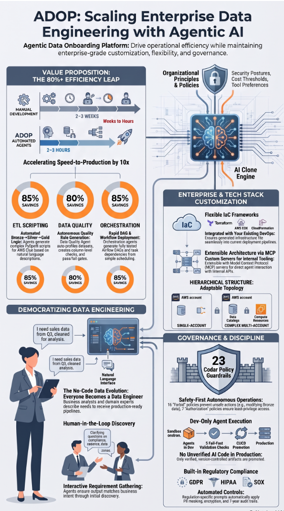
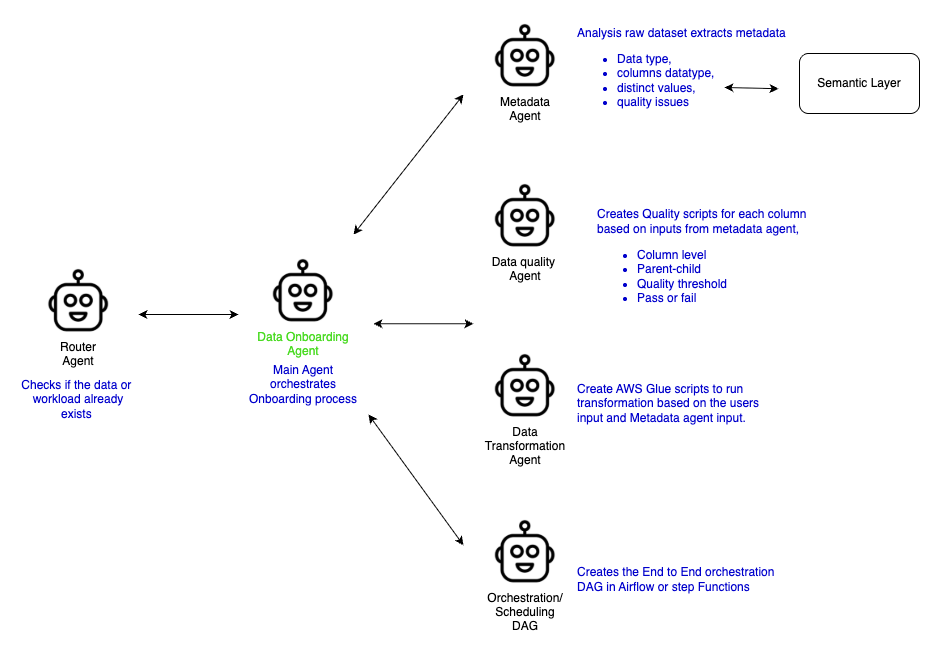
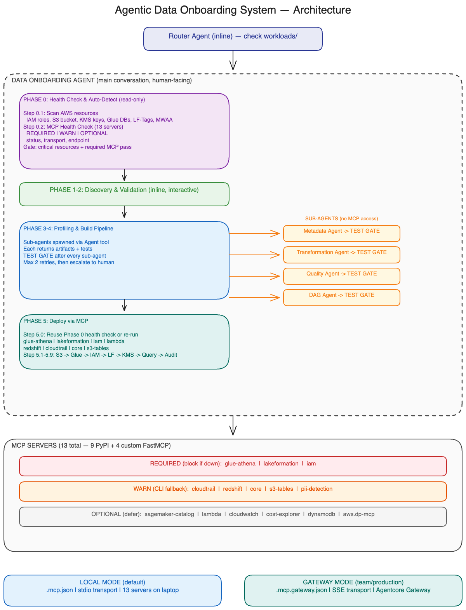

# ADOP Multi-Agent Data Operations Platform

<p align="center">
  
  <br/>
  <strong>One data-operations platform for multiple AI coding agents</strong>
  <br/>
  <a href="https://aws-samples.github.io/sample-Agentic-Ai-Data-Operations/">
    <strong>&#128194; View the styled documentation site &rarr;</strong>
  </a>
  <br/>
  <sub>Full-page layout with sidebar navigation, side-by-side hero, and step-by-step flow diagrams.</sub>
</p>



**Automate your entire data operations pipeline** — ETL, data quality, semantic layer population, and data analysis — **reducing development time from weeks to hours.** The same human-approved requirements, contracts, quality gates, tracing, and deterministic code generation are exposed through Claude Code, Codex, Amazon Q Developer, and Kiro.

This repository is the multi-agent integration layer for the Agentic Data
Onboarding Platform (ADOP). Each client keeps its native configuration and
interaction model; shared contracts and evidence rules keep the resulting
workloads consistent.

## Platform surfaces

| Platform | Native entry point | Agent/workflow surface | Requirements capture | Renderer |
|---|---|---|---|---|
| Claude Code | `CLAUDE.md`, `.claude/`, plugin package | Commands, agents, hooks, plugin | `UserPromptSubmit` and Q&A hooks | `plugins/claude-code/scripts/adop_render.py` |
| Codex | `AGENTS.md`, `.codex/`, `scripts/start_codex.py` | Skills, TOML agent contracts, hooks, MCP | Codex hooks and shared ledger | Shared deterministic renderer |
| Amazon Q Developer | `AmazonQ.md`, `.amazonq/` | CLI agents and rules | Explicit CLI capture fallback | Shared deterministic renderer |
| Kiro | `.kiro/` | Agents, steering, hooks, workflow driver | Hook plus pending-ledger fallback | `.kiro/adop/render.sh` |

The adapter snapshots under `adapters/` are portable native surfaces. The
root-level files are the combined project surface. The packaged Claude plugin
is installable independently and vendors the shared runtime it needs.

## Dynamic workflows

The workflow is client-neutral. Codex exposes the richest native dynamic
workflow commands, while Claude Code, Amazon Q, and Kiro map the same phases
to their own commands, agents, hooks, and steering files.

| Command | Purpose | What it does |
|---|---|---|
| `$command-onboard-workflow [REGULATION]` | Build a data pipeline | Parallel sub-agents generate specs for Bronze→Silver→Gold pipeline (~15 agents, 10-20 min) |
| `$command-devops-workflow [WORKLOAD] [FRAMEWORK]` | Production readiness | Parallel IaC + monitoring + cost tags + runbook generation (~8 agents, 5-10 min) |

Both commands ask discovery questions first, then fan out parallel agents.
Progress is persisted under each workload's `run/` directory.

Codex skill definitions:
`.codex/skills/command-onboard-workflow/SKILL.md`,
`.codex/skills/command-devops-workflow/SKILL.md`.

## Native integration map

| Surface | Repository location | Purpose |
|---|---|---|
| Shared project rules | `AGENTS.md`, `CLAUDE.md`, `AmazonQ.md` | Human-in-the-loop, security, zones, logging, and code-generation rules |
| Claude Code | `.claude/`, `.claude-plugin/`, `plugins/claude-code/` | Native commands, agents, hooks, plugin, and renderer |
| Codex | `.codex/`, `scripts/start_codex.py` | Skills, agent contracts, hooks, and clone-safe MCP startup |
| Amazon Q Developer | `.amazonq/` | CLI agents, MCP configuration, and explicit capture fallback |
| Kiro | `.kiro/`, `scripts/kiro_workflow.py` | Steering, agents, hooks, renderer, phase gate, and run-state driver |
| Shared contracts | `contracts/`, `core/`, `shared/` | Schemas, requirements audit, capture, templates, and codegen |
| Integration snapshots | `adapters/` | Portable per-client copies for installation or comparison |
| MCP profiles | `mcp-profiles/` | Default, demo, and disabled third-party MCP profiles |
| Custom MCP servers | `mcp-servers/` | Repository-owned FastMCP implementations |
| Platform alignment | `scripts/sync_platforms.py` | Clone-readiness, profile parity, and workload structure checks |

See [Platform integration and clone-ready structure](docs/platform-integration.md)
for the full folder and file ownership model.

---

## Starting the Agent

Open any supported client in this repo and describe **where the data lives,
where it's going, the cadence, and any compliance requirements**. The Data
Onboarding Agent asks clarifying questions, then coordinates sub-agents to
generate a fully tested workload under `workloads/<name>/`.

Platform-specific entry points:

- Claude Code: use `/adop:onboard-workflow` or the native `.claude/` command.
- Codex: run `python3 scripts/start_codex.py`, then use `$command-onboard-workflow [REGULATION]`.
- Amazon Q Developer: use the ADOP orchestrator CLI agent in `.amazonq/`.
- Kiro: initialize with `python3 scripts/kiro_workflow.py init --workload <name>`,
  then use the Kiro steering and agent surfaces.

All platforms use the same discovery gate, workload conventions, requirements
ledger, artifact evidence, and promotion audit.

**A good prompt includes:**
- **Source** (S3 path / Kafka topic / Kinesis stream / JDBC)
- **Sink cadence** (batch daily / micro-batch / streaming)
- **Target zones** (Silver quality rules, Gold transformations)
- **Compliance** (GDPR, CCPA, HIPAA, SOX, PCI DSS — or none)

## Shared workflow contract

The client surface changes, but the lifecycle does not:

```text
Phase 0  Health check and source auto-discovery
Phase 1  Human discovery gate
Phase 2  Deduplication, validation, and run context
Phase 3  Profiling and human confirmation
Phase 4  Spec generation, rendering, and test gates
Audit    Requirements conformance before promotion
Phase 5  Deployment through approved MCP/AWS paths
5.9      Post-deployment verification
5.10     Optional end-to-end pipeline test
5.11     Optional DevOps production-readiness workflow
```

The requirements auditor runs across all clients. It compares the captured
human Q&A with `run/context.json`, `run/requirements.jsonl`, decisions,
conversation events, operational traces, tests, generated artifacts, and
deployment evidence. Missing or conflicting evidence blocks promotion.

Generated scripts, DAGs, and SQL must come from the deterministic renderer and
carry provenance headers. The drift validator rejects artifacts that no longer
match their validated specification and template.

## Design-principle contracts — the source of truth

ADOP uses two related kinds of contracts:

1. **Concept contracts** define what must be true about a source and each data
   zone. They are the design authority for agents and humans.
2. **Schema contracts** define how those decisions are represented and
   validated. They are the executable JSON Schemas under
   [`contracts/`](contracts/README.md).

The order of authority is: human-approved answers and Q&A → concept contract →
versioned schema contract → Cedar policies and quality gates → deterministic
renderer. Agents may profile data and report observations, but they must not
invent missing business rules. If a required answer is absent or conflicts
with an observation, the workflow pauses for the human.

### Zone concept contracts

| Zone | Concept contract | Non-negotiable design principles | Contracted decisions |
|---|---|---|---|
| **Bronze** | Immutable source-preservation boundary | Keep the received data faithful to the source; do not apply business transformations; preserve lineage; encrypt and audit access; retries must be idempotent | Source path, source format, landing location, catalog registration, retention, ingestion pattern, and replay/idempotency key |
| **Silver** | Validated, standardized, reusable data boundary | Write Apache Iceberg; apply only human-approved cleaning and transformations; make schema and quality explicit; detect and protect PII; never silently drop records | Primary key, deduplication strategy and ordering, null handling, casts, masking, schema evolution, quality thresholds, and quarantine behavior |
| **Gold** | Business-purpose serving boundary | Publish only data needed for an approved use case; make grain and KPI formulas explicit; preserve traceable lineage to Silver; block promotion below the quality gate | Business outcome, dimensions, temporal grain, measures, schema type (`star_schema`, `flat_iceberg`, or `iceberg_dynamodb`), consumers, and retention |

The default quality gates are **Silver ≥ 0.80** and **Gold ≥ 0.95**. A
critical quality failure blocks promotion. Bronze has no promotion score
because its contract is preservation, not business readiness.

### Source concept contracts

Every workload must declare one source type in
`workloads/{name}/config/source.yaml`. The source contract is confirmed during
Phase 1 discovery, written into the requirements ledger, and validated against
[`source_profile.schema.json`](contracts/v1/source_profile.schema.json).

| Source type | Concept contract | Required design decisions before generation |
|---|---|---|
| **CSV / Parquet / JSON / Avro** | File or object ingestion with explicit format and schema handling | Location, format, partitioning, arrival pattern, schema evolution, malformed-record policy, completeness check, retention, and replay behavior |
| **JDBC** | Transactional database extraction without embedding credentials | Secret/connection reference, database and table or query, primary key, incremental watermark, isolation/consistency, extraction window, and failure/retry behavior |
| **Kafka** | Replayable event-stream ingestion | Bootstrap/cluster reference, topic, event key, consumer group, offset/replay policy, schema registry or event schema, ordering assumptions, and late-event handling |
| **Kinesis** | AWS stream ingestion with checkpointed replay | Stream, partition-key strategy, consumer/checkpoint location, retention window, trigger interval, shard/throughput assumptions, and late-event handling |

Source type and file format are different decisions: for example, a JDBC
source may return CSV only after an export, while a Kinesis source carries
JSON or Avro records. The contract records both instead of allowing an agent
to infer one from the other.

### How contracts move through the workflow

```text
Human Q&A + auto-discovered observations
        ↓
source.yaml + zone specifications
        ↓  validate against contracts/v1 or contracts/v2
run/context.json + requirements.jsonl
        ↓
Cedar authorization + quality gates + requirements auditor
        ↓
deterministic renderer
        ↓
scripts, SQL, DAGs, tests, deployment evidence
```

The contract is created before artifact generation. The agent may create the
initial structured draft from the user's confirmed answers, but it cannot mark
the contract complete until the required human decisions are captured and
audited. Generated artifacts are evidence of the contract; they do not
override it. See [`contracts/README.md`](contracts/README.md),
[`AGENTS.md`](AGENTS.md), and the
[discovery protocol](.codex/skills/discovery-protocol/SKILL.md) for the
enforcement details.

## Current support and roadmap

| Capability | Status |
|---|---|
| Glue PySpark, Iceberg, Athena, Airflow/MWAA | Implemented |
| Claude Code, Codex, Amazon Q Developer, Kiro integrations | Implemented integration surfaces |
| Requirements capture, audit, tracing, and artifact evidence | Implemented |
| Snowflake, Databricks, and Teradata MCP connections | Optional client profiles added; disabled by default |
| EMR Spark runtime adapter | Future; portable Spark fields can be added without changing business specs |
| dbt project/model/test generation | Future adapter |
| Snowflake execution and deployment verification | Future adapter |

The current workload generator is optimized for Glue PySpark and Iceberg.
Future execution targets should reuse the same business, quality, compliance,
and requirements contracts while translating them into backend-specific
artifacts. Runtime settings such as Spark memory, workers, warehouses, and
threads belong in a separate execution-target configuration rather than in
transformation business rules.

## Third-party data ecosystems

ADOP can use a third-party platform as a governed data source, execution
target, or semantic/query system. The preferred integration boundary is the
provider's native MCP endpoint, registered in the selected coding client.
ADOP does not place provider credentials, tokens, account identifiers, or
private endpoints in workload code or generated artifacts.

The integration pattern is:

```text
provider-native MCP endpoint
        ↓
Claude Code / Codex / Amazon Q / Kiro MCP configuration
        ↓
ADOP Phase 0 health check and tool inventory
        ↓
read-only profiling and schema discovery
        ↓
human confirmation + requirements audit
        ↓
generated workload artifacts and provider-specific deployment adapter
```

Use separate read-only discovery tools from mutation/deployment tools. A
provider MCP connection being reachable does not grant permission to every
underlying table, warehouse, catalog, job, or procedure; authorization must be
checked at the provider and tool level.

### Snowflake native MCP

Snowflake's managed MCP server can expose Cortex Agents, Cortex Analyst,
Cortex Search, SQL execution, and custom UDF/stored-procedure tools. It is
useful in ADOP for:

- schema and metadata discovery during Phase 0/3;
- governed natural-language analysis through Cortex Analyst or Cortex Agents;
- read-only validation queries after a dbt/Snowflake workload is deployed;
- carefully scoped custom tools for platform-specific operations.

The managed endpoint follows this form:

```text
https://<account_url>/api/v2/databases/<database>/schemas/<schema>/mcp-servers/<name>
```

Recommended ADOP setup:

1. Create a dedicated Snowflake MCP server in a controlled database/schema.
2. Prefer exposing a governed Cortex Agent as the client-facing tool.
3. Keep direct `SYSTEM_EXECUTE_SQL` read-only and separate from the governed
   agent server when direct SQL is genuinely required.
4. Use Snowflake OAuth or External OAuth; do not commit PATs or client secrets.
5. Grant a dedicated least-privilege role `USAGE` on the MCP server and only
   the underlying semantic views, tables, search services, agents, UDFs, or
   procedures required by the selected tools.
6. Set a default role and warehouse for the MCP identity and verify the
   effective role during the Phase 0 health check.

Example client-neutral remote MCP shape:

```json
{
  "mcpServers": {
    "snowflake-native": {
      "type": "http",
      "url": "https://<account_url>/api/v2/databases/<database>/schemas/<schema>/mcp-servers/<name>",
      "oauth": {
        "client_id": "${SNOWFLAKE_MCP_CLIENT_ID}",
        "client_secret": "${SNOWFLAKE_MCP_CLIENT_SECRET}"
      }
    }
  }
}
```

The exact configuration key names differ by client. Use the native Claude,
Codex, Amazon Q, or Kiro MCP configuration format and keep secrets in the
client's supported secret store or environment mechanism.

Authoritative references:

- [Snowflake-managed MCP server](https://docs.snowflake.com/en/user-guide/snowflake-cortex/cortex-agents-mcp)
- [Snowflake MCP client support](https://docs.snowflake.com/en/user-guide/cortex-code/cortex-code-mcp)

### Databricks native MCP

Databricks supports MCP services managed through Unity Catalog and AI Gateway.
It can register an external MCP endpoint through an HTTP connection, restrict
the exposed tools, grant principals `EXECUTE` on the MCP service, and expose
built-in MCP services from the `system.ai` schema where available. Databricks
Apps can also host a custom MCP server at an HTTPS endpoint, normally using
the `/mcp` path.

The managed AI Gateway endpoint follows this form:

```text
https://<workspace-hostname>/ai-gateway/mcp-services/<catalog>.<schema>.<service>
```

Recommended ADOP setup:

1. Register the provider or external MCP endpoint as a Unity Catalog HTTP
   connection; keep bearer tokens and OAuth credentials outside Git.
2. Create a Databricks MCP service and use tool selection to expose only the
   required tools.
3. Grant only the required Unity Catalog permissions and `EXECUTE` on the MCP
   service to the ADOP integration principal.
4. Use read-only tools for schema discovery and profiling; separate write
   tools for deployment or job operations.
5. Run a Phase 0 connectivity and `tools/list` check before profiling.
6. Record the workspace, catalog, schema, service, principal, and selected
   tools as deployment evidence without recording access tokens.

Example client-neutral remote MCP shape:

```json
{
  "mcpServers": {
    "databricks-native": {
      "type": "http",
      "url": "https://<workspace-hostname>/ai-gateway/mcp-services/<catalog>.<schema>.<service>",
      "headers": {
        "Authorization": "Bearer ${DATABRICKS_MCP_TOKEN}"
      }
    }
  }
}
```

For Databricks Apps-hosted custom MCP servers, use the app's HTTPS MCP URL
instead and ensure the caller has the required app permission. The ADOP
workload should reference the logical provider/service name, not a hardcoded
token or local credential file.

Authoritative references:

- [Databricks custom MCP servers](https://docs.databricks.com/aws/en/agents/mcp-tools/custom-mcp)
- [Databricks MCP API and SDK reference](https://docs.databricks.com/aws/en/ai-gateway/mcp-service-reference)

### Provider-neutral ADOP changes

The current bundle ships disabled native MCP connection entries for Snowflake,
Databricks, and Teradata, but does not yet ship provider-specific deployment
adapters. See [`mcp-profiles/third-party/README.md`](mcp-profiles/third-party/README.md).
The next provider-neutral
extension should add:

- a versioned execution-target contract for `aws_glue`, `emr_spark`,
  `dbt_snowflake`, and `databricks`;
- provider-neutral `runtime.yaml` values for target, region/workspace,
  database/catalog/schema, warehouse or cluster, retry policy, and tool
  allowlist;
- client-specific MCP registration examples without copying credentials into
  the repository;
- provider-aware Phase 0 health checks and post-deployment verification;
- requirements-auditor evidence linking user requirements to SQL/dbt models,
  notebooks/jobs, tables, tests, and deployment results.

### Example 1 — Batch from S3 (CSV, daily) with Dynamic Workflow
```
$command-onboard-workflow HIPAA

Onboard claims data from s3://data-lake-<account>-us-east-1/bronze/claims/ingestion_date=YYYY-MM-DD/claims.csv
into Silver with dedup on claim_id and not-null policy_number, and into a flat denormalized
Gold Iceberg table with derived measures (net_paid_ratio, days_to_submission, denial_category).
Run daily at 03:00 UTC. Apply HIPAA controls with PHI masking in Silver and PHI suppression in Gold.
```

> The `$command-onboard-workflow HIPAA` prefix triggers parallel execution via Dynamic Workflow.
> HIPAA changes the compliance controls and review requirements; it does not hard-code a model.

### Example 2 — Streaming from Kafka (Glue Streaming ETL)
```
$command-onboard-workflow PCI

Onboard transaction events from Kafka topic `payments.auth.v1` (bootstrap:
b-1.msk-prod.kafka.us-east-1.amazonaws.com:9098, IAM auth) using AWS Glue Streaming ETL.
Land micro-batches every 60s into Bronze Iceberg on S3, dedup on event_id in Silver
with schema validation, and aggregate to 5-minute windows in Gold (fraud_score by merchant, rolling
auth_rate). Apply PCI DSS — tokenize PAN, drop CVV, Luhn check as a quality rule.
```

### Example 3 — Streaming from Kinesis (Glue Streaming ETL)
```
$command-onboard-workflow GDPR

Onboard clickstream events from Kinesis Data Stream `web-events-prod` (shard count 8,
PutRecord enhanced fan-out consumer) using AWS Glue Streaming ETL with a checkpoint on S3.
Write Bronze Iceberg on 1-minute triggers, Silver with session stitching on user_id + 30-min
inactivity gap, Gold hourly rollups (page_views, unique_users, bounce_rate by traffic_source).
Apply GDPR — consent-based filter on user_id, 365-day retention, right-to-erasure hook.
```

### Prompt Depth: Brief vs. Detailed

You can be brief or detailed — the agent asks clarifying questions either way. Here's the same dataset at two levels of detail:

**High-level** (agent fills in defaults, keeps moving):
```
Onboard e-commerce orders from s3://your-landing-bucket/ecommerce_orders/

- CSV, 50 rows, GDPR, daily 09:30 UTC batch
- Gold: flat denormalized table for ad-hoc queries (no star schema)
- DQ: completeness > 85%, validate dates/emails/phones, quarantine bad rows
- Transforms: mask credit cards, standardize phones, cast dates, derive order_month + days_to_ship

Print a status box after each phase. Don't ask questions — use defaults and keep moving.
```

**Deep-dive** (fully specified, no questions needed):
```
Onboard a new e-commerce orders dataset.

Source:
- Location: s3://your-landing-bucket/ecommerce_orders/
- Format: CSV, 50 rows, batch ingestion
- Refresh: Daily at 09:30 UTC

Compliance: GDPR
- PII columns: customer_email, customer_phone, credit_card_number, customer_name, shipping_address
- Require consent tracking, right-to-erasure support, 365-day retention

Gold Zone: Flat denormalized table for ad-hoc analytics (NO star schema)

Data Quality Rules:
- Completeness threshold: 85% (block promotion if below)
- Validate order_date format (reject invalid dates like month > 12)
- Validate customer_email format (must contain @)
- Validate customer_phone format (reject non-numeric junk)
- Flag invalid credit_card_number values
- Flag rows missing city/state/zip as incomplete
- Anomaly: flag orders where total_amount != quantity × unit_price × (1 - discount_pct)

Transformations (Bronze → Silver):
- Standardize phone to E.164 format
- Mask credit_card_number (show last 4 only: ****-****-****-1234)
- Cast order_date and ship_date to DATE type
- Trim whitespace on all string columns
- Quarantine rows with invalid dates (don't drop silently)

Transformations (Silver → Gold):
- Flatten all columns into single wide table
- Add derived columns: order_month, days_to_ship, is_returned, is_high_value (total > $100)
- Keep only delivered + returned orders (exclude processing/cancelled)

Schedule: Daily batch at 09:30 UTC, retries=3, exponential backoff, alert on failure
```

Watch the agent run, approve the plan it presents, and the artifacts land under `workloads/<name>/` (config, scripts, DAG, tests, ontology).

---

## Why Agentify Data Operations?

Traditional data pipeline development is slow, manual, and error-prone:
- **Weeks of manual coding** for ETL scripts, quality checks, and orchestration DAGs
- **Repetitive boilerplate** across similar data sources (CSV ingestion patterns, PII detection, quality rules)
- **Knowledge scattered** across Confluence docs, Slack threads, and tribal knowledge
- **Quality issues discovered in production** instead of during development

**This platform agentifies the entire data operations workflow:**

| Traditional Approach | Agentic Approach | Time Saved |
|---------------------|------------------|------------|
| Data engineer writes PySpark ETL (2-3 days) | **Data Onboarding Agent** generates Bronze→Silver→Gold scripts from natural language (15 minutes) | **95%** |
| Manually create quality rules per column (1-2 days) | **Data Quality Agent** auto-generates column-level checks from profiling (10 minutes) | **90%** |
| Write Airflow DAG with task dependencies (1 day) | **Orchestration Agent** generates tested DAG from schedule config (15 minutes) | **95%** |
| Author OWL ontology + R2RML mappings by hand (1-2 weeks) | **Ontology Staging Agent** induces OWL + R2RML from `semantic.yaml` + Glue (10 minutes) | **99%** |
| Debug recurring pipeline failures (ongoing) | **Prompt Intelligence Agent** learns from failures, prevents recurrence (automated) | **Hours per week** |

**Result: Data pipeline development goes from 2-3 weeks → 2-3 hours.**

---

## How It Works

**Built as a multi-agent platform.** Claude Code, Codex, Amazon Q Developer,
and Kiro use different configuration formats and hook contracts, but they share
the same workflow phases, contracts, workload structure, requirements auditor,
security rules, and artifact evidence model. The `adapters/` directory contains
portable native snapshots; the root files provide the combined project surface.

Other coding agents can be added through the same adapter pattern. An adapter
must preserve the human discovery gate, requirements ledger, test gates,
deterministic renderer, trace contract, and audit behavior.

**All agents run in the Development environment only.** Generated scripts and configurations are version-controlled and promoted to higher environments (QA, Staging, Production) through standard CI/CD pipelines. Agents do not run in production — only the artifacts they generate.

---

## 1. Data Onboarding Agent

**Purpose:** Automates the entire Bronze→Silver→Gold pipeline creation process from a natural language description.

**Runs in:** Development environment only
**Output:** Version-controlled scripts, configs, DAGs, and tests → promoted to higher environments via CI/CD

A user describes their data source in natural language. The **Data Onboarding Agent** coordinates specialized sub-agents to generate a complete, tested pipeline — config files, transformation scripts, quality checks, and an Airflow DAG — without writing any code manually.

### Agent Coordination Workflow



**The Data Onboarding Agent (center) orchestrates specialized sub-agents. The Router Agent gates entry on the left; Glue Catalog, Semantic Layer (OWL/SHACL), Decision Engine, Memory, and Agentrace logs are shared services on the right.**

1. **Router Agent** — Checks if the data or workload already exists in `workloads/`
2. **Metadata Agent** — Analyzes raw dataset, extracts metadata (data types, column datatypes, distinct values, quality issues), stores business context in **Semantic Layer**
3. **Ontology Agent** — Induces the OWL ontology for the Semantic Layer from Glue/SageMaker Catalog metadata (data types, column datatypes, distinct values, quality issues)
4. **Data Quality Agent** — Creates quality scripts for each column based on metadata agent inputs (column-level checks, parent-child relationships, quality thresholds, pass/fail gates)
5. **Data Transformation Agent** — Creates AWS Glue scripts to run transformations (Bronze→Silver→Gold) based on user input and metadata agent analysis
6. **Orchestration/Scheduling DAG Agent** — Creates the end-to-end orchestration DAG in Airflow or Step Functions
7. **DevOps Agent** — Creates CloudFormation, Terraform, and AWS CDK to promote the generated artifacts to higher environments

**Workflow (two execution modes):**

| Mode | Invocation | Phase 4 | Wall Clock | Token Cost |
|------|-----------|---------|------------|------------|
| **Sequential** (standard) | Paste prompt directly | Sub-agents run one at a time | ~30 min | 1x |
| **Dynamic Workflow** (parallel) | `$command-onboard-workflow [REGULATION]` | Sub-agents run in parallel | ~15-20 min | 3-5x |

```
# Standard mode:
User: "Onboard customer data from PostgreSQL, daily refresh, PII masking required"

# Workflow mode (parallel, faster, resumable):
User: "$command-onboard-workflow HIPAA"
User: "Onboard patient records from S3..."
```

**Phases (both modes):**
```
Phase 0: Health Check ─ verify AWS resources + the default AWS MCP profile (optional servers are opt-in)
Phase 1: Discovery ─── asks source, schema, cleaning rules, quality thresholds, schedule
Phase 2: Dedup ─────── checks existing workloads for overlaps, reuses shared assets
Phase 3: Profile ───── samples 5% of data, detects PII, presents metadata for approval
Phase 4: Build ─────── spawns 4 sub-agents → each writes artifacts + tests → TEST GATE
Phase 4.5: Validate ── checks Python syntax, DAG parsing, imports, Airflow best practices
Phase 5: Deploy ────── uploads to S3, creates Glue catalog, applies LF-Tags, verifies

Output: workloads/{dataset_name}/ with config/, scripts/, dags/, sql/, tests/
```

**Dynamic Workflow advantages** (via `$command-onboard-workflow`):
- Metadata + Quality agents run in parallel (Phase 4 Stage 1)
- Reasoning routing: compliance-critical work uses higher-effort generation and review contracts
- Validation agents use lower-effort checks where the contract permits
- Multi-workload batch: onboard multiple datasets in one invocation
- Resumable: completed phases survive disconnects

See `.codex/skills/command-onboard-workflow/SKILL.md` for the skill definition and
`workloads/customer_master/` for a committed example workload.

### Workload Memory (Persistent Learning)

Each workload maintains its own memory system in `workloads/{name}/memory/` that accumulates knowledge across pipeline runs — schema quirks, quality thresholds, operator preferences, and successful patterns — enabling future runs to start with context instead of cold discovery. When the same workload is re-processed, the agent loads this memory first, pre-filling known answers and avoiding repetitive questions, while continuously learning from new failures and successes to prevent recurring issues.

---

## 2. Ontology Staging Agent (AWS Semantic Layer Handoff)

**Purpose:** Induces an OWL ontology + R2RML mappings from each workload's `semantic.yaml` + Glue Catalog schema, staged locally for handoff to **AWS Semantic Layer** (upcoming AWS Semantic Layer platform, currently in development).

**Runs in:** Development environment only (emits files to `workloads/{name}/config/`)
**Output:** `ontology.ttl` (OWL2 classes/properties/hierarchy), `mappings.ttl` (R2RML linking classes to Glue tables), `ontology_manifest.json` (version, checksums, steward checklist)

**Scope boundary:** ADOP generates and validates Turtle locally. ADOP does **NOT** run T-Box reasoning, author SHACL constraints, or publish to a VKG — those are the Data Steward's responsibilities inside the AWS Semantic Layer platform when the AWS Semantic Layer platform deploys.

**How it works:**

1. **OWL induction** — `semantic.yaml` entities → owl:Class, dimension/measure/temporal columns → owl:DatatypeProperty with xsd ranges, relationships → owl:ObjectProperty (+ owl:FunctionalProperty for many-to-one), hierarchies → rdfs:subClassOf chain, PII flags → ex:piiClassification annotations, Glue-only columns → ex:autoInduced annotation.
2. **R2RML mapping** — one TriplesMap per entity, logical table = Athena SQL against the Gold zone, subject URI template = `http://semantic.aws/{namespace}/data/{ClassName}/{pk}`, FK columns emit `rr:parentTriplesMap` references.
3. **Turtle validation** — parse with `rdflib`, auto-fix common issues (unescaped quotes, missing semicolons), retry up to 2 times.
4. **Staging** — write 3 artifacts to `workloads/{name}/config/` with SHA-256 checksums and `"state": "STAGED_LOCAL"`. Data Steward picks these up for AWS Semantic Layer publish.

When the AWS Semantic Layer platform is deployed, a follow-up `ontology-publish-agent` (future) will read the committed TTL files and push them to Neptune SPARQL + S3 + DynamoDB + SNS.

---

## 3. Environment Setup Agent

**Purpose:** Automates one-time AWS infrastructure provisioning and MCP server deployment across local and cloud modes.

**Runs in:** Development environment only (one-time setup)
**Output:** AWS resources (S3, Glue, KMS, IAM), MCP server configurations, Agentcore Gateway/Runtime (optional)

The Environment Setup Agent handles the foundational infrastructure setup that must happen before any data onboarding can begin. This includes AWS resource provisioning (S3 buckets, KMS keys, Glue databases, Lake Formation settings), MCP server installation and health checks, and optional Agentcore Gateway deployment for shared cloud-hosted tool access.

---

## 4. Semantic Layer (Business Context + Ontology Handoff)

**Purpose:** Captures business context (column roles, dimension hierarchies, relationships, PII flags) in `semantic.yaml` and emits a formal OWL ontology + R2RML mappings for handoff to **AWS Semantic Layer** — the upcoming AWS Semantic Layer platform responsible for NL→SQL, reasoning, SHACL validation, and VKG publish.

**Runs in:** Development (config authoring + ontology induction)
**Output:** `workloads/{name}/config/semantic.yaml` (source of truth), `ontology.ttl` (OWL2), `mappings.ttl` (R2RML), `ontology_manifest.json`. All committed to git.

The semantic layer captures column roles (measures, dimensions, temporal, identifiers), hierarchical relationships (country→state→city), business terms, and PII classifications. **SageMaker Catalog** mirrors this on the Glue Data Catalog as custom metadata properties so downstream consumers see business context alongside technical schemas.

At Phase 7 Step 8.5 of the deploy flow, the **Ontology Staging Agent** induces an OWL ontology from `semantic.yaml` + the deployed Glue Gold table schema, generates R2RML mappings wiring each OWL class to its physical table, and validates Turtle syntax with rdflib. The resulting `ontology.ttl` + `mappings.ttl` + `ontology_manifest.json` land in `workloads/{name}/config/` for AWS Semantic Layer to pick up.

**Hard boundary:** ADOP stops at emission. AWS Semantic Layer (in development) owns SHACL authoring, T-Box reasoning (HermiT/ELK), VKG publish (Ontop), and NL→SQL runtime. When the AWS Semantic Layer platform deploys, a future publish agent will push the committed TTL files from local to Neptune SPARQL + S3 + DynamoDB + SNS — no regeneration needed because the inducer is deterministic.

---

## 5. AI Clone Decision Engine

**Purpose:** An AI clone of you (or your organization) that makes tooling decisions the way you would — dynamically selecting the optimal tool for each operation based on your principles, available infrastructure, and real-time health status.

**Runs in:** All phases (continuous tool selection)
**Output:** Tool routing decisions, fallback strategies, organizational compliance reports

The AI Clone learns how you pick tools — your preferences, security posture, cost sensitivity, and fallback habits — then makes those decisions autonomously at runtime. It maintains a live inventory of available MCP servers, CLI tools, and cloud services, routing each operation the way you would based on performance requirements, security policies, cost optimization, and organizational preferences (e.g., "always use MCP over CLI when available" or "prefer Athena over Redshift for ad-hoc queries").

You encode your decision-making into policy files: tool preferences, security constraints (e.g., "PII operations must use designated KMS keys"), cost thresholds, and failover strategies. The clone evaluates these rules in real-time during pipeline execution, automatically falling back to alternative tools when primary choices are unavailable or violate your policies — exactly as you would if you were making the call yourself.

This means the same pipeline code runs across different environments without you being present. Your clone carries your judgment: startups might default to cost-optimized tools while enterprises enforce security-first tool selection — the clone adapts to whichever context it's deployed in, applying your encoded principles consistently.

### How the Decision Engine Works

The tool selection process follows a 5-step hierarchy, defined across three configuration layers:

```
User Intent → Step 1: Context Check → Step 2: Server Health → Step 3: Intent Match
           → Step 4: Fallback Strategy → Step 5: Invariant Enforcement
```

**Configuration Sources:**

| File | Role |
|------|------|
| [`TOOL_ROUTING.md`](TOOL_ROUTING.md) | Intent-to-tool mapping — matches natural language intent to specific MCP tools with `not_when` disqualifiers |
| [`tool-registry/servers.yaml`](tool-registry/servers.yaml) | Single source of truth for 13 MCP servers — category, tools, fallbacks |
| [`tool-registry/invariants.yaml`](tool-registry/invariants.yaml) | 11 mandatory rules (BLOCK/WARN severity) enforced regardless of phase |
| [`MCP_GUARDRAILS.md`](MCP_GUARDRAILS.md) | Per-phase guardrails — exact tool names allowed per deploy step |
| [`AGENTS.md`](AGENTS.md) | Architecture constraints — sub-agent limitations, MCP-first rule |

### Step 1 — Context Gate (Sub-Agent vs Main Conversation)

```
Am I a sub-agent?
├── YES → STOP. Generate files only. No MCP, no AWS, no CLI.
└── NO  → Proceed to Step 2
```

Sub-agents (Metadata, Transformation, Quality, DAG) have zero tool access by design — enforced by Cedar policy (`shared/policies/agent_authorization/`) and the `sub-agent-no-mcp` invariant.

### Step 2 — Server Health (3-Tier Classification)

Before selecting a tool, the engine checks server availability from Phase 0 health check:

| Tier | Servers | On Failure |
|------|---------|-----------|
| **REQUIRED** | `glue-athena`, `lakeformation`, `iam` | **Block** — cannot proceed |
| **WARN** | `cloudtrail`, `redshift`, `core`, `s3-tables`, `pii-detection` | **CLI fallback** + log warning |
| **OPTIONAL** | `sagemaker-catalog`, `lambda`, `cloudwatch`, `cost-explorer`, `dynamodb` | **Defer** — skip gracefully |

### Step 3 — Intent Matching

Each user operation is matched against intent phrases in `TOOL_ROUTING.md`:

```yaml
# Example: User says "check data quality in Silver"
tool: glue-data-quality
intent: ["run quality rules", "check completeness", "validate Silver data", "quality gate"]
use: aws glue start-data-quality-ruleset-evaluation-run CLI (DQDL syntax)
not_when: Quick one-off check — Athena SQL is faster
mcp_server: glue-athena (REQUIRED)
```

The `not_when` field acts as a negative filter — if the disqualifier condition is true, skip this tool and try the next match.

### Step 4 — Fallback Chain

When the primary tool is unavailable:

```
MCP tool available?
├── YES → Use MCP (preferred, always first)
└── NO  → Is it REQUIRED tier?
    ├── YES → BLOCK operation, escalate to human
    └── NO  → Use CLI fallback + log: "Warning: MCP fallback — {server} not loaded"
```

### Step 5 — Invariant Enforcement (11 Rules, Always Active)

Regardless of which tool is selected, these rules are enforced on every operation:

| ID | Rule | Severity |
|----|------|----------|
| `lineage-always` | `--enable-data-lineage: true` on every Glue ETL job | BLOCK |
| `no-credentials-in-code` | Credentials via Secrets Manager or Airflow Connections only | BLOCK |
| `bronze-immutable` | Bronze zone data never modified after ingestion | BLOCK |
| `quality-gates` | Silver >= 80%, Gold >= 95%; critical failures block promotion | BLOCK |
| `sub-agent-no-mcp` | Sub-agents generate artifacts only; no MCP, no AWS execution | BLOCK |
| `iam-simulate-first` | `simulate_principal_policy` must return allowed before source access | BLOCK |
| `verify-deployment` | Confirm tables queryable after deploy (Redshift or Athena) | BLOCK |
| `audit-after-deploy` | Run CloudTrail lookup after deploy to confirm logging | BLOCK |
| `log-cli-fallback` | Print warning message on every CLI fallback | WARN |
| `zone-scoped-kms` | Separate CMK for Bronze, Silver, Gold per workload | BLOCK |
| `mcp-first` | Use MCP tools FIRST; CLI only when unavailable or errored | BLOCK |

### Validation (CI-Enforced)

The tool registry is validated by `scripts/validate_tool_registry.py` (18 tests):
- `servers.yaml` ↔ `.mcp.json` — every server in YAML must exist in MCP config
- `servers.yaml` ↔ `TOOL_ROUTING.md` — every server referenced in routing docs must exist in registry
- `invariants.yaml` ↔ `TOOL_ROUTING.md` — mandatory rules in YAML match what's documented
- No stale references — tools referenced in docs that no longer exist are caught

---

## 6. Prompt Intelligence Agent (Self-Healing)

**Purpose:** Learns from pipeline failures across all workloads and generates recommendations to prevent recurring issues.

**Runs in:** Development environment only
**Output:** Analysis reports with prompt patches, best practices, estimated time savings

The system **learns from mistakes** by analyzing trace logs from failed and successful pipeline runs across all workloads, then generates actionable recommendations to prevent recurring failures.

### What It Does

1. **Pattern Detection**: Scans `trace_events.jsonl` across all workloads to find recurring errors
2. **Cross-Workload Learning**: Groups identical failures (e.g., "KeyError: 'primary_key'" in 3+ workloads)
3. **Root Cause Analysis**: Explains why the pattern occurs (e.g., "CSV sources lack explicit PK column")
4. **Actionable Recommendations**: Generates ready-to-paste prompt patches to prevent recurrence
5. **Best Practice Extraction**: Identifies high-confidence decisions from successful runs

### When It Runs

- **Nightly (automated)**: `evolve` command analyzes traces, generates patches, and auto-grafts high-confidence fixes to ADOP_WORKFLOWS.md
- **Weekly (human review)**: Review pending patches (confidence 0.60-0.79) and approve or reject
- **On-demand**: After major failures or before deployments

```bash
# Self-healing loop: analyze → generate patches → auto-apply to ADOP_WORKFLOWS.md
python3 -m shared.prompt_intelligence.cli evolve --auto-graft --min-confidence 0.80

# Review pending patches
python3 -m shared.prompt_intelligence.cli patches --status pending

# Revert a bad patch
python3 -m shared.prompt_intelligence.cli prune --patch-id abc123

# Legacy: analysis-only (generates report, does not apply patches)
python3 -m shared.prompt_intelligence.cli analyze --all
```

**Example output:**
```
✓ Found 2 cross-workload failure patterns

Top Failure Patterns:
  1. KeyError: 'primary_key'
     Frequency: 3, Workloads: 3, Confidence: 0.78
     Impact: BLOCKING

Recommendation: For CSV sources, ALWAYS ask 'What is the primary key?'
                before profiling. Add to discovery checklist.

Estimated Time Saved: 10-15 hours across future onboardings
```

**Report includes:**
- **Executive Summary**: Impact distribution (BLOCKING/DEGRADED/MINOR), top blockers, estimated time savings
- **Failure Patterns**: Grouped by impact with root cause analysis and prompt patches (ready to copy-paste into prompt files)
- **Best Practices**: High-confidence successful decisions to adopt across workloads
- **Implementation Guide**: Step-by-step instructions for applying fixes

See [shared/prompt_intelligence/QUICKSTART.md](shared/prompt_intelligence/QUICKSTART.md) for 3-minute start guide.

---

## 7. DevOps Agent

**Purpose:** Automates IaC generation, monitoring, cost optimization, and operational runbooks for deployed pipelines.

**Runs in:** Development environment (generates IaC, monitoring configs, runbooks — human applies)
**Output:** Terraform/CDK/CFN, CloudWatch dashboards, SNS alerts, cost tags, budget alerts, RUNBOOK.md

### Available Now: `$command-devops-workflow`

```bash
$command-devops-workflow customer_master terraform
```

Triggers a Dynamic Workflow that generates everything in parallel:

| Phase | Agents | Output |
|---|---|---|
| IaC Generate | 1 medium-effort agent | `iac/terraform/main.tf` + variables + outputs + APPLY_GUIDE.md |
| Monitoring | 1 medium-effort agent | CloudWatch alarms + SNS topic + EventBridge rules + dashboard |
| Cost & Tags | 1 medium-effort agent | Cost allocation tags + budget alerts + lifecycle policies |
| Runbook | 1 medium-effort agent | RUNBOOK.md (failure recovery, escalation, maintenance) |
| Security Review | 1 high-effort agent | Adversarial IaC review (no wildcards, no public access) |
| Validate | 2 low-effort checks | Syntax checks (terraform fmt, cfn-lint) |

### Planned Features (Q3 2026)

- **CI/CD Pipelines** — Git push → auto-deploy to QA/Staging/Prod
- **Self-Healing** — Auto-retries transient failures, scales resources based on data volume
- **Quality Drift Detection** — Alerts when data quality scores drop below historical baseline
- **Resource Scaling** — Right-sizes Glue jobs, Athena query concurrency based on usage patterns

---

## Environment Model: Dev-Only Agent Execution

**Critical principle:** All agents run **only in the Development environment**. Higher environments (QA, Staging, Production) execute only the generated scripts and configurations.

| Environment | What Runs | How |
|-------------|-----------|-----|
| **Development** | Active agents: Data Onboarding, Ontology Staging, Environment Setup, Prompt Intelligence, and platform-specific adapter agents. | Interactive through the selected supported client |
| **QA/Staging** | Generated scripts/DAGs/configs only | Deployed via CI/CD (GitHub Actions, MWAA) |
| **Production** | Generated scripts/DAGs/configs only | Promoted via CI/CD after QA approval |

**Artifact Promotion Flow:**
```
Dev Agent → Generate scripts/tests → Commit to Git → CI/CD pipeline → QA → Staging → Prod
          ↓
      Run tests locally
      Validate syntax/best practices
      Human approval
```

**Why this matters:**
- **Security**: Agents don't need production AWS credentials
- **Auditability**: All changes are version-controlled, peer-reviewed
- **Reproducibility**: Same scripts run identically across all environments
- **Rollback**: Git history enables instant rollback to previous working version

---

## Architecture

### System Overview



### Pipeline Flow (Phase 0 → Phase 5)

See [workflow diagrams](docs/workflow-diagrams.md) for the pipeline flow and phase diagrams.

### Data Zones (Medallion Pattern)

| Zone | Purpose | Format | Quality Gate |
|------|---------|--------|--------------|
| **Bronze** | Raw, immutable ingestion | Source format (CSV, JSON, Parquet) | None |
| **Silver** | Cleaned, validated, schema-enforced | Apache Iceberg on S3 Tables | Score >= 80% |
| **Gold** | Curated, business-ready | Iceberg (star schema or flat) | Score >= 95% |

### AWS Services

| Service | Purpose |
|---------|---------|
| S3 + S3 Tables | Data lake storage (Bronze/Silver/Gold zones) |
| AWS Glue | ETL jobs, crawlers, Data Catalog |
| Amazon Athena | SQL queries on Iceberg tables |
| Apache Iceberg | Table format (ACID, time-travel, schema evolution) |
| AWS KMS | Encryption at rest (zone-specific keys) |
| Lake Formation | Column-level security via LF-Tags |
| Amazon MWAA | Airflow orchestration |
| SageMaker Catalog | Business metadata (custom columns on Glue Catalog entries) |
| Ontology artifacts (local) | `workloads/{name}/config/ontology.ttl` + `mappings.ttl` for AWS Semantic Layer handoff |

### Semantic Layer

The semantic layer in ADOP has two responsibilities: (1) capture business context in `semantic.yaml` and mirror it to SageMaker Catalog, (2) emit OWL + R2RML artifacts for handoff to the AWS Semantic Layer (upcoming).

### Deployment Topology

By default the platform deploys to a single AWS account: Glue Data Catalog, Lake Formation, Glue jobs, MWAA, and S3 all live together. An opt-in multi-account topology is supported where the Glue catalog + Lake Formation live in one account ("Account A") and Glue jobs + MWAA + S3 live in a consumer account ("Account B"). The setup and onboarding prompts ask a single-vs-multi question up front; when multi is chosen, the generated IaC, PySpark, DAG, and deploy scripts all parameterize `catalog_account_id` and emit `sts:AssumeRole` wiring. See [`docs/multi-account-deployment.md`](docs/multi-account-deployment.md) for AWS pre-requisites and known limits (read-only from A to B today; write-back requires RAM).

**How it works:**
1. **Input**: Define business context in `workloads/{name}/config/semantic.yaml` (column roles, aggregations, relationships, business terms, hierarchies, PII flags). Source of truth.
2. **Mirror to SageMaker Catalog**: Column roles, PII flags, and business terms are written as custom metadata on Glue Data Catalog entries so downstream tools see business context alongside technical schemas.
3. **Induce OWL + R2RML** (Phase 7 Step 8.5): The Ontology Staging Agent converts `semantic.yaml` + Glue schema into `ontology.ttl` (OWL2) + `mappings.ttl` (R2RML) + `ontology_manifest.json`. Validated with rdflib, committed to git.
4. **AWS Semantic Layer handoff**: Data Steward picks up the committed TTL files in AWS Semantic Layer (when deployed) for SHACL authoring, T-Box reasoning, and VKG publish.

**What ADOP does NOT do:**
- NL→SQL query generation (AWS Semantic Layer's VKG)
- SHACL constraint authoring (Data Steward in the AWS Semantic Layer)
- T-Box reasoning (AWS Semantic Layer, at publish time)
- Any SPARQL/Neptune writes (future, when the AWS Semantic Layer platform deploys)

### MCP Servers (Model Context Protocol)

The default MCP profile exposes only the AWS managed MCP server through the
AWS Agent Toolkit (`aws-mcp`). This keeps startup, permissions, and cost
bounded while giving the main conversation a single AWS capability surface.
Credentials come from the normal AWS credential chain; they are never stored in
the repository.

The specific AWS and ADOP servers listed below remain available as opt-in
profiles in `.mcp.optional.json`, `.codex/config.optional.toml`, and the
corresponding native adapter files. They are not loaded by default.

**PyPI Servers (9)** — installed automatically via `uvx`:

| Server | Package | Purpose |
|--------|---------|---------|
| `core` | awslabs-aws-api-mcp-server | S3 operations, KMS key management, Secrets Manager |
| `iam` | awslabs-iam-mcp-server | Role lookup, permission simulation, policy management |
| `lambda` | awslabs-lambda-tool-mcp-server | Lambda invocation, Lake Formation grants via Lambda |
| `s3-tables` | awslabs-s3-tables-mcp-server | S3 Tables (Iceberg) management |
| `cloudtrail` | awslabs-cloudtrail-mcp-server | Audit trail verification, compliance checks |
| `redshift` | awslabs-redshift-mcp-server | Schema verification, Gold zone queries via Spectrum |
| `cloudwatch` | awslabs-cloudwatch-mcp-server | Logs, metrics, alarms |
| `cost-explorer` | awslabs-billing-cost-management-mcp-server | Cost tracking, budget analysis |
| `dynamodb` | awslabs-dynamodb-mcp-server | DynamoDB operations (operational state, API cache) |

**Custom Servers (4)** — built in-house using FastMCP, in `mcp-servers/`:

| Server | Tools | Purpose |
|--------|-------|---------|
| `glue-athena` | 19 | Glue catalog CRUD, crawler management, ETL job creation/control, synchronous Athena queries |
| `lakeformation` | 9 | LF-Tag create/apply/remove, TBAC grant/revoke, column-level security |
| `sagemaker-catalog` | 5 | Business metadata (column roles, PII flags, hierarchies) on Glue tables |
| `pii-detection` | 6 | AI-driven PII detection + automatic LF-Tag application |

**Quick start** (after cloning):
```bash
# Prerequisites: uv installed, AWS credentials configured
# The default profile loads only aws-mcp
python3 scripts/validate_integrations.py
```

**Live end-to-end demo** (existing AWS account):
```bash
python3 scripts/mcp_demo.py check --profile demo
python3 scripts/mcp_demo.py activate --profile demo --apply
```

The demo profile enables only the capabilities needed for Glue, S3, Athena,
Lake Formation, PII detection, CloudWatch debugging, and CloudTrail audit
verification. It backs up the normal profiles and requires a client restart.
Restore the prior configuration with the backup path printed by the command.

**Health check before deployment**: the AWS MCP profile must be connected and
the main conversation must verify the specific capabilities needed by the
workload. If a required capability is unavailable through the default AWS MCP,
enable the smallest matching optional server profile and record the reason.
See [MCP Setup Guide](docs/mcp-setup.md) for enablement and health checks.

### Agentcore (Optional Cloud Deployment)

All 13 MCP servers can be deployed to **Agentcore Gateway** for shared, cloud-hosted tool access -- no local Python, uv, or stdio transport needed per user. The **Data Onboarding Agent** can be deployed to **Agentcore Runtime** for API-accessible invocation, with all 13 tools connected from Gateway.

```
Local Mode (default)           Agentcore Mode
────────────────────           ────────────────────────
Client → stdio → aws-mcp       Client / API Agent
  optional servers                → Runtime (agent)
                                  → Gateway (AWS + optional targets)
```

- Deploy Gateway (all 13 servers): `runbooks/environment-setup-agent/02-deploy-agentcore-gateway.md`
- Deploy Runtime (agent + Gateway tools): `runbooks/environment-setup-agent/03-deploy-agentcore-runtime.md`
- Config + 13 IAM policies: `runbooks/environment-setup-agent/agentcore/`

See [runbooks/environment-setup-agent/agentcore/README.md](runbooks/environment-setup-agent/agentcore/README.md) for details.

---

## Project Structure

```
.
├── shared/                           # Reusable runtime code, policies, templates, and tracing
├── contracts/                        # Versioned JSON schemas for workload specifications
├── runbooks/                         # Shared agent procedures and workflow instructions
├── mcp-profiles/                     # Default, demo, and disabled third-party MCP profiles
├── mcp-servers/                      # Repository-owned custom MCP implementations
├── tool-registry/                    # Canonical MCP server and invariant registry
├── scripts/                          # Validation, sync, capture, and demo utilities
├── workloads/                        # One generated pipeline directory per dataset
│   └── customer_orders/              # Current checked-in workload
├── core/                             # Requirements-auditor contract, implementation, and tests
├── adapters/                         # Portable native snapshots for each client
├── plugins/                          # Installable Claude Code plugin package
├── docs/                             # Architecture, setup, testing, and operations docs
│
├── .claude/                          # Clone-ready Claude Code project surface
├── .codex/                           # Clone-ready Codex project surface
├── .amazonq/                         # Clone-ready Amazon Q project surface
├── .kiro/                            # Clone-ready Kiro project surface
├── .mcp.json                         # Clone-ready default MCP profile
│
├── AGENTS.md                         # Codex project instructions
├── CLAUDE.md                         # Claude Code project instructions
├── AmazonQ.md                         # Amazon Q project instructions
├── SKILLS.md                         # Shared agent behavior and workflow rules
├── ADOP_WORKFLOWS.md                 # Shared workflow definitions
├── TOOL_ROUTING.md                   # Tool selection and routing rules
├── MCP_GUARDRAILS.md                 # MCP permissions and safety guardrails
├── manifest.yaml                     # Multi-client integration manifest
└── pyproject.toml                    # Python project configuration
```

### Workload Structure (generated per dataset)

```
workloads/{dataset_name}/
├── config/
│   ├── source.yaml                   # Connection details, format, frequency
│   ├── semantic.yaml                 # Column roles, business context, PII flags
│   ├── transformations.yaml          # Cleaning rules, Gold zone schema
│   ├── quality_rules.yaml            # Thresholds, critical rules
│   └── schedule.yaml                 # Cron, dependencies, failure handling
├── run/                              # Per-run shared state (written end of Phase 2)
│   ├── context.json                  # human_answers + progress — authoritative, read-only
│   └── decisions.jsonl               # Append-only sub-agent decisions
├── scripts/
│   ├── extract/                      # Ingestion from source to Bronze
│   ├── transform/                    # Bronze→Silver→Gold (Glue PySpark)
│   ├── quality/                      # Quality check execution
│   └── load/                         # Catalog registration
├── dags/
│   └── {dataset_name}_dag.py         # Airflow DAG (independent per workload)
├── sql/
│   ├── bronze/                       # DDL for raw tables
│   ├── silver/                       # DDL for cleaned tables
│   └── gold/                         # DDL for curated tables
├── memory/                           # Persistent workload memory (accumulated learnings)
│   ├── MEMORY.md                     # Ledger index (auto-rebuilt, 200-line cap)
│   └── *.md                          # Memory files with YAML frontmatter
├── logs/                             # Execution traces (trace_events.jsonl, run_*/)
├── tests/
│   ├── unit/                         # Self-contained tests (no dependencies)
│   └── integration/                  # Tests requiring pipeline output
└── README.md
```

---

## Getting Started

### Prerequisites

- Python 3.10+
- AWS account with Glue, Athena, S3, MWAA configured
- At least one supported client: Claude Code, Codex, Amazon Q Developer, or Kiro

### Run Tests Locally

```bash
# Install the bundle's Python dependencies
pip install -e .

# Validate all four integrations and the shared requirements auditor
python3 scripts/run_tests.py

# Run workload tests when a workload is present
pytest workloads/ -v

# Unit tests only (no prerequisites)
pytest workloads/*/tests/unit/ -v
```

See [Running Tests](docs/running-tests.md) for complete test guide including data generation.

### Onboard a New Dataset

Using Codex, describe your data source:

```
"Onboard customer_orders from our PostgreSQL database.
 Daily refresh at 6 AM UTC. Contains PII (email, phone).
 Need star schema in Gold zone for reporting dashboards."
```

The agent will:
1. Ask clarifying questions (schema, cleaning rules, quality thresholds)
2. Check for duplicate sources in existing workloads
3. Profile a sample of your data
4. Generate all pipeline artifacts with tests
5. Present artifacts for your approval before writing

### Deploy to AWS

```bash
# Upload workload to MWAA S3 bucket
aws s3 sync workloads/{dataset}/ s3://{mwaa-bucket}/dags/workloads/{dataset}/
aws s3 sync shared/ s3://{mwaa-bucket}/dags/shared/

# The workload's DAG will appear in MWAA Airflow UI
```

### Post-Deployment Verification (Mandatory)

After deploying, run the end-to-end verification to confirm everything works:

```bash
uv run --no-project --with boto3 python3 shared/utils/post_deployment_verifier.py \
  --workload {dataset} \
  --database {dataset}_db \
  --tables silver_{dataset} gold_{dataset}_analytical \
  --kms-key alias/hipaa-phi-key \
  --mwaa-env {your-mwaa-environment} \
  --dag-id {dataset}_pipeline
```

**7 automated checks** (all must PASS):
1. Glue tables exist in catalog
2. Athena queries return data (not empty)
3. LF-Tags applied on all PHI columns
4. TBAC access control restricts CRITICAL columns
5. KMS key exists with rotation enabled
6. MWAA DAG loaded without import errors
7. CloudTrail audit events logged

Deployment is NOT complete until all checks pass. See `shared/utils/post_deployment_verifier.py`.

See [docs/aws-account-setup.md](docs/aws-account-setup.md) for AWS configuration details.

---

## Key Features

### PII Detection and Governance
- AI-driven detection of 12 PII types (EMAIL, PHONE, SSN, CREDIT_CARD, etc.)
- Lake Formation LF-Tags for column-level access control
- 4 sensitivity levels: CRITICAL, HIGH, MEDIUM, LOW
- Integrated into profiling phase — runs automatically on every dataset
- **Regulation-specific prompts** for GDPR, CCPA, HIPAA, SOX, PCI DSS — see [runbooks/data-onboarding-agent/regulation/](runbooks/data-onboarding-agent/regulation/). Each prompt contains self-contained controls (retention, masking, LF-Tags, TBAC grants, audit, quality rules) applied only when a regulation is selected during discovery

### Quality Gates
- 5 dimensions: Completeness, Accuracy, Consistency, Validity, Uniqueness
- Critical rule failures block zone promotion regardless of overall score
- Anomaly detection for outliers, distribution shifts, volume changes
- Historical comparison against baseline

### Cedar Policy Guardrails
- 16 forbid policies preventing unsafe operations (e.g., Bronze mutation, quality bypass)
- 7 agent authorization policies controlling which agent can do what
- Dual-mode: local evaluation (cedarpy) or AWS Verified Permissions

### REIC: RAG-Enhanced Intent Classification
Inspired by the REIC research paper on improving intent routing for multi-agent systems:

- **Problem**: The Router Agent used exact string matching — "CRM data" wouldn't find `customer_master` because the words don't literally match
- **Solution**: Vector similarity search (TF-IDF with FAISS upgrade path) over workload metadata — compares *meaning*, not exact strings
- **How it works**: Reads every workload's `source.yaml` + `semantic.yaml`, extracts keywords (column names, descriptions, tags, business terms), and builds a searchable index. Incoming intents are scored against all workloads using cosine similarity.
- **3-level hierarchical routing**: Phase (discovery/build/deploy) → Agent (constrained by phase) → Action (specific operation) — each level uses softmax probabilities for deterministic, ranked selection
- **No heavy dependencies**: Real ML embeddings (sentence-transformers + FAISS) are optional. Falls back to TF-IDF (stdlib only, no installs). Set `REIC_ENABLED=false` to disable entirely — existing routing still works.
- **74 tests** validating determinism, confidence bounds, phase constraints, and end-to-end intent classification

```
# Before REIC                          # After REIC
User: "CRM data"                       User: "CRM data"
→ grep for "CRM data"                  → TF-IDF similarity search
→ no match                             → customer_master (score: 0.82)
→ "not onboarded" (wrong)              → "Found customer_master" (correct)
```

### Deep Agent Tracing (Three-Layer Observability)
Inspired by the **AgentTrace** research paper (Gao et al., 2025) on debugging and understanding multi-agent systems, adapted for our LLM sub-agent architecture where you cannot instrument agent reasoning externally.

**Problem**: Traditional agent tracing assumes Python classes you can wrap with decorators. Our agents are Codex LLM sub-agents (prompt templates in ADOP_WORKFLOWS.md) — their reasoning is a black box.

**Solution**: Three instrumentable layers, linked by `run_id` + `parent_span_id`:

| Layer | What It Captures | How |
|-------|-----------------|-----|
| **1. Orchestrator** | Phase transitions, test gates, retries, span hierarchy | `OrchestratorLogger` + `AgentTracer` (Python, fully instrumentable) |
| **2. Generated Scripts** | Row counts, transforms applied, quality scores, errors | `StructuredLogger` wired into Glue ETL scripts |
| **3. LLM Self-Reporting** | Reasoning, alternatives considered, rejection reasons, confidence | `AgentOutput.decisions[]` array (prompt engineering, not instrumentation) |

**Three-surface event model** (from AgentTrace): Every trace event is classified as **operational** (what happened), **cognitive** (why it happened), or **contextual** (what surrounded it). This lets you filter traces by concern — debugging failed pipelines vs. understanding agent decisions vs. correlating across workloads.

**OTel-compatible fields**: ~15 fields per event (slimmed from AgentTrace's 30+ to only fields we can actually populate — no token counts from client sub-agents). Output is JSONL, parseable by jq, CloudWatch, Splunk.

**CLI viewer** (`shared/logging/trace_viewer.py`): `--summary`, `--decisions`, `--timeline`, `--failures`, `--export-md` (narrative), `--export-map` (decision tree).

```
# View agent reasoning for a pipeline run
python3 -m shared.logging.trace_viewer trace_events.jsonl --decisions

  [1] schema_inference — Metadata Agent (phase 4)
      Reasoning: CSV headers suggest financial data. ticker is PK, current_price is decimal.
      Choice:    12 columns: 2 identifiers, 6 measures, 3 dimensions, 1 temporal
      Confidence: high

  [2] transformation_choice — Transformation Agent (phase 4)
      Reasoning: Dedup by ticker, type-cast to decimal, validate positive prices.
      Alternatives: dedup by composite key (rejected: no date column for freshness)
      Confidence: high
```

### Typed Sub-Agent Outputs
Sub-agents do not return free-form markdown. Every sub-agent returns a structured `AgentOutput` payload, validated on arrival. Two transports, one schema:

- **`from_agent_message()`**: Some client sub-agents have no tool-call channel, so they end their final message with a fenced ```json block. This extracts it — last block wins — and rejects payloads missing required fields.
- **`SUBMIT_OUTPUT_TOOL`** + **`from_bedrock_tool_call()`**: For Bedrock `converse()` callers, a `toolSpec` in `shared/templates/agent_output_schema.py` forces the same JSON via `tool_choice`.
- **`REQUIRED_OUTPUT_FIELDS`**: Derived from `SUBMIT_OUTPUT_TOOL`, so the two transports cannot drift apart.
- **Forward-compatible `from_dict()`**: Filters unknown keys, so old serialized data works with new fields and new data works with old code.
- **`memory_hints`**: New optional field where sub-agents flag durable facts worth remembering (e.g., "pe_ratio has expected 5% nulls — do not quarantine"). These feed directly into the workload memory system.

### Workload Memory (Per-Dataset Persistent Learning)
Each workload accumulates knowledge across pipeline runs — schema quirks, quality thresholds, operator preferences — stored as structured `.md` files with YAML frontmatter in a `memory/` directory. Future runs start with context instead of cold.

- **Storage**: `workloads/{name}/memory/` directory with a `MEMORY.md` ledger (200-line cap, 25KB cap) and individual memory files
- **Four memory types**: `user` (operator preferences), `feedback` (corrections), `project` (schema facts), `reference` (S3 paths, Glue DB names)
- **Memory-aware discovery**: Phase 1 loads the workload ledger before asking questions. Known answers are pre-filled and confirmed, not re-asked.
- **Memory selection**: `find_relevant_memories()` selects up to 5 relevant memory files from the manifest before each phase — keeping sub-agent context lean.
- **Post-run extraction**: After each test gate passes, `extract_memories_from_run()` harvests durable learnings from the agent's decisions and memory hints. Runs asynchronously — never blocks the pipeline.

```
Run 1: Pipeline fails on pe_ratio nulls → agent learns "pe_ratio has expected 5% nulls"
Run 2: Memory loaded → Quality Agent reads the hint → test gate passes without human intervention
```

### Adaptive Prompt Evolution (Self-Healing Loop)
Closes the gap in prompt intelligence: patches were generated in reports but **never applied**. The new `PromptEvolver` stores, tracks, and auto-applies learned prompt patches to ADOP_WORKFLOWS.md.

- **Patch registry**: `shared/prompt_intelligence/patches/` stores `.patch` files with YAML frontmatter (confidence, status, section). `PATCH_INDEX.md` tracks all patches.
- **Confidence gate**: Patches with confidence >= 0.80 are auto-grafted to ADOP_WORKFLOWS.md. Below 0.80, they're stored as "pending" for human review.
- **Reversible**: Every grafted patch is wrapped in `<!-- GRAFT: {id} -->` markers. `prune_patch()` removes it cleanly.
- **CLI**: `evolve` (full self-healing cycle), `patches` (list registry), `prune` (revert a bad patch)

```
Before: Pipeline fails → report suggests fix → human reads report (never) → same failure repeats
After:  Pipeline fails → nightly evolve runs → patch auto-grafted → next run succeeds
```

### Deterministic Agent Output
Inspired by the **GCC (Guardrails, Cognitive traces, Checksums)** pattern for making LLM-based multi-agent systems reproducible and auditable:

- **Input/Output Hashing**: SHA-256 checksums on all inputs and generated artifacts. Same inputs must produce identical outputs — verified by comparing hashes across runs.
- **Ordered Outputs**: Dictionary keys sorted alphabetically, lists sorted by stable keys (column name, rule_id). Deterministic YAML serialization via `shared/utils/deterministic_yaml.py`.
- **Fixed Timestamps**: Generated artifacts use run start time (`started_at`), not `datetime.now()`, preventing timestamp drift between identical runs.
- **Seeded Randomness**: Any randomness uses `random_seed` from run context. Never `random()` without a seed.
- **Idempotency Checks**: Before writing any file — same checksum skips, different checksum overwrites + logs diff, missing file creates.
- **Template Versioning**: Every generated file includes a header with agent name, template version, and input hash for traceability.
- **Cognitive Traces**: Every sub-agent must include a `decisions[]` array documenting every significant choice, alternatives considered, and rejection reasons — making LLM "thinking" auditable.
- **Template-Driven Codegen**: All pipeline scripts and DAGs are generated from Jinja2 templates (`shared/templates/*.j2`) driven by spec contracts (`contracts/v1/*.schema.json`). The `shared/codegen/` module loads config, validates against schemas, extracts typed slots, renders templates, and validates drift. A PreToolUse hook blocks any direct write to artifact directories without the renderer token. See [docs/determinism.md](docs/determinism.md) for architecture details.

### Agent Exchange Display

Every agent interaction is rendered in a structured ASCII format for traceability. Example:

```text
+--------------------------------------------------------------------+
|  QUERY                                                             |
+--------------------------------------------------------------------+
|  "Profile customer churn dataset and propose onboarding DAG"       |
|  source: data_onboarding | user: claims_v2 | ts: 2026-05-21T06:00 |
+--------------------------------------------------------------------+
                              |
                              v
+--------------------------------------------------------------------+
|  AGENT RESPONSE                                                    |
+--------------------------------------------------------------------+
|  >> Generated profiling plan and DAG skeleton                      |
|  STATUS: OK                                                        |
|  tokens: 3.2k | latency: 4.1s | cost: n/a                         |
+--------------------------------------------------------------------+
```

Discovery findings are presented in visual blocks before asking questions:

```text
+--------------------------------------------------------------------+
|  DISCOVERED: Source Profile                                        |
+--------------------------------------------------------------------+
|  * Format: CSV, 31 columns, 50 rows                               |
|  * Likely PK: claim_id (unique, 0% nulls)                         |
|  * PHI detected: member_ssn, member_dob, member_email              |
|  * Measures: billed_amount, allowed_amount, paid_amount            |
|  * Temporal: service_date, submission_date                         |
+--------------------------------------------------------------------+
```

The `shared/utils/ascii_display.py` module provides reusable builders: `query_block()`, `response_block()`, `exchange_block()`, `discovery_block()`, `entity_block()`, `checklist_block()`.

### Cedar Policy Guardrails
Uses **Amazon Cedar** (the policy language behind Amazon Verified Permissions) to enforce safety invariants across the pipeline — 23 policies total:

**16 Forbid Policies** (guardrails — things that must NEVER happen):
| Category | Policies | Examples |
|----------|----------|---------|
| **Data Quality** (4) | Quality gate thresholds, no critical failures, no silent row drops, row count range checks | `dq_001`: Silver requires score >= 0.80, Gold >= 0.95 |
| **Security** (4) | KMS key validation, PII masking, TLS enforcement, credential protection | `sec_003`: PII columns must be masked in logs and query results |
| **Integrity** (4) | Landing/Bronze immutability, FK integrity, derived column formulas, schema enforcement | `int_001`: Bronze zone data is NEVER modified after ingestion |
| **Operations** (4) | Idempotency, encryption re-keying at zone boundaries, audit log immutability, Iceberg metadata | `ops_001`: Running a transform twice must produce identical output |

**7 Agent Authorization Policies** (who can do what):
Each agent (Router, Onboarding, Metadata, Transformation, Quality, DAG, Analysis) has a Cedar permit policy defining exactly which actions it can perform on which resources — enforcing least-privilege at the agent level.

**Dual-mode evaluation**: `shared/utils/cedar_client.py` evaluates policies locally (cedarpy) for testing or via AWS Verified Permissions (boto3) for production. Setup script at `runbooks/environment-setup-agent/scripts/setup_avp.py` syncs all policies to AVP.

### Test-Driven Pipeline Generation
- Every sub-agent writes unit + integration tests alongside artifacts
- Tests must pass before the orchestrator proceeds (max 2 retries)
- 780+ passing tests across 11 workloads, all runnable locally without AWS
- Tool-registry validation tests (18) ensure routing docs never drift from `.mcp.json`

### Pre-Deployment Code Validation (Step 4.5.1)
Automatically validates all generated code BEFORE deployment to catch 95% of issues in seconds vs. minutes of MWAA debugging:

**5 validation checks** (fail-fast):
1. **Python syntax**: All scripts compile without errors (`py_compile`)
2. **DAG parsing**: Airflow can import the DAG file without exceptions
3. **Import resolution**: All `from X import Y` statements resolve
4. **Airflow best practices**: 8 patterns enforced (context manager, retries, no hardcoded paths, etc.)
5. **YAML syntax**: All config files parse correctly

**Auto-fix policy**: Errors are fixed inline (max 2 attempts), no human intervention for syntax errors

**Why it matters**: MWAA takes 1-2 minutes to refresh DAGs after S3 upload. A parsing error blocks ALL DAGs from loading. This step prevents wasted deployment cycles.


## Example Workloads

| Workload | Tests | Status | Key Features |
|----------|-------|--------|-------------|
| `sales_transactions` | 196 | Local | Basic Bronze→Silver→Gold, quality checks |
| `customer_master` | 118 | Local | KMS encryption, PII masking, Iceberg tables |
| `order_transactions` | 70 | Local | FK validation, star schema, aggregate calculations |
| `product_inventory` | 23 + 18* | Local | Advanced quality rules, quarantine handling |
| `us_mutual_funds_etf` | 321 + 44* | Deployed | PII detection, QuickSight dashboards, MWAA DAG |
| `financial_portfolios` | 200+ | Deployed | SOX compliance, 7 Iceberg tables, MWAA DAG |
| `healthcare_patients` | Generated | Deployed | HIPAA compliance, PHI masking, TBAC, MWAA DAG |
| `employee_attendance` | 40 | Local | PII (NAME, EMAIL), star schema, SCD2, GDPR, tool-routing validation |
| `stocks` | Generated | Local | Stocks pipeline |
| `daily_sales` | Generated | Local | Daily sales aggregation |
| `claims` | Generated | Local | HIPAA compliance, PHI masking, flat denormalized Gold, daily 9AM AEST |

*Some tests require PySpark (Java) or pipeline output to be generated first. See [Running Tests](docs/running-tests.md).

---

## Documentation

| Document | Purpose |
|----------|---------|
| [AGENTS.md](AGENTS.md) | Agent configuration, security rules, data zone rules |
| [ADOP_WORKFLOWS.md](ADOP_WORKFLOWS.md) | Agent skill definitions, spawn prompts, workflows |
| [TOOL_ROUTING.md](TOOL_ROUTING.md) | **Read first** — tool selection (intent routing, server status, code examples, mandatory rules) |
| [MCP_GUARDRAILS.md](MCP_GUARDRAILS.md) | Per-phase runtime guardrails (exact MCP tool names per deploy step) |
| [tool-registry/](tool-registry/) | Canonical YAML registry (servers.yaml + invariants.yaml), validated by CI |
| [Workflow Diagrams](docs/workflow-diagrams.md) | Visual workflow and data flow diagrams |
| [MCP Setup](docs/mcp-setup.md) | MCP server configuration |
| [Security](docs/security.md) | Security practices |
| [Running Tests](docs/running-tests.md) | Test execution guide |
| [docs/aws-account-setup.md](docs/aws-account-setup.md) | AWS prerequisites |
| [runbooks/environment-setup-agent/agentcore/README.md](runbooks/environment-setup-agent/agentcore/README.md) | Agentcore Gateway + Runtime (optional) |
| [docs/getting-started.md](docs/getting-started.md) | Quick start guide |

---

## Technology Stack

- **Language**: Python (Glue PySpark + Airflow DAGs)
- **Table Format**: Apache Iceberg (ACID, time-travel, schema evolution)
- **Orchestration**: Apache Airflow (MWAA)
- **Cloud**: AWS (S3, Glue, Athena, Lake Formation, KMS, MWAA)
- **Testing**: pytest (unit + integration, property-based with fast-check)
- **Tool Routing**: YAML registry (`tool-registry/`) + intent-based decision tree, validated by pre-commit
- **Intent Routing**: REIC (TF-IDF / FAISS vector similarity + hierarchical classification)
- **Policy Engine**: Cedar (23 policies via Amazon Verified Permissions)
- **Agent Tracing**: AgentTrace-inspired three-layer observability (OTel-compatible JSONL)
- **Determinism**: GCC pattern (guardrails + cognitive traces + checksums)
- **AI Integration**: MCP (Model Context Protocol) for standardized AWS access

---

## Data Security

The platform enforces security at every layer:

- **Encryption**: AES-256 at rest (zone-specific KMS keys), TLS 1.3 in transit, re-encryption at zone boundaries
- **PII Detection**: Automatic AI-driven scanning of all columns (name-based + content-based patterns) — see `shared/utils/pii_detection_and_tagging.py`
- **Column-Level Access**: Lake Formation LF-Tags (`PII_Classification`, `PII_Type`, `Data_Sensitivity`) enable tag-based access control (TBAC) — analysts see only what their role permits
- **Regulatory Compliance**: Self-contained prompt per regulation in [runbooks/data-onboarding-agent/regulation/](runbooks/data-onboarding-agent/regulation/):
  - **GDPR** — right to erasure, consent tracking, 365-day retention, data minimization
  - **CCPA** — right to know/delete, opt-out tracking, 730-day retention, data lineage
  - **HIPAA** — PHI encryption, minimum necessary access, BAA, 7-year audit trail
  - **SOX** — financial integrity, 0.95+ quality gates, immutable Bronze, 7-year retention
  - **PCI DSS** — cardholder data tokenization, CVV drop, restricted `pci_admin_role` access
- **Cedar Policies**: 16 forbid policies + 7 agent authorization policies enforcing safety invariants (no Bronze mutation, no quality bypass, PII masking in logs)
- **Audit Logging**: CloudTrail for all Lake Formation operations — who accessed what column, when tags changed, all permission grants
- **Bronze Immutability**: Source data is never modified after ingestion

See [Security](docs/security.md) for more information.

---

## Cost Estimation (LLM Token Usage)

> **Disclaimer:** The following are estimates based on observed trace durations and agent complexity for the `financial_portfolios` workload (the only fully-traced end-to-end run). Actual token usage varies by dataset complexity, number of columns, cleaning rules, and human interaction. These figures do not include AWS infrastructure costs (Glue jobs, S3, Athena queries, etc.).

### Per-Workload Onboarding (End-to-End)

| Phase | Agent | Est. Tokens | Notes |
|-------|-------|-------------|-------|
| 0 | Health Check & Auto-Detect | ~2K | Mostly API calls, minimal LLM |
| 1-2 | Discovery + Dedup | ~5K | Questions, validation, source scanning |
| 3 | Profiling | ~8K | Schema inference, PII detection, cognitive decisions |
| 4a | Metadata Agent | ~25K | Schema design, semantic.yaml, source.yaml + tests |
| 4b | Transformation Agent | ~45K | Bronze→Silver→Gold scripts + tests (largest agent) |
| 4c | Quality Agent | ~20K | Quality rules, threshold selection + tests |
| 4d | DAG Agent | ~20K | Airflow DAG, schedule config + tests |
| 5 | Deploy to AWS | ~10K | MCP tool calls (API-heavy, not LLM-heavy) |
| | **Total per workload** | **~135K** | Input + output tokens combined |

### Cost Guidance

This repository does not pin a Codex model or publish a price estimate. Usage and pricing depend
on the Codex surface, account, selected model, reasoning effort, context size, and retries. Use
the current Codex usage view or official OpenAI pricing documentation for the account running the
workflow.

### Platform-Wide Estimate (All Workloads)

| Metric | Value |
|--------|-------|
| Workloads onboarded | 9 |
| Avg tokens per workload | ~135K |
| Total estimated tokens | ~1.2M |
| **Model cost** | Use the active Codex usage view |
| **AWS cost** | Track Glue, S3, Athena, MWAA, QuickSight, and Agentcore separately |

### Cost Optimization Tips

- Use `low` reasoning effort for deterministic validation where appropriate
- Use `medium` for standard artifact generation
- Use `high` for compliance-sensitive orchestration and adversarial review
- **Workload memory** reduces re-runs — learned facts carry forward, fewer retry cycles
- **REIC routing** prevents mis-classification — correct agent on first try saves wasted tokens
- Keep skills focused and use workload memory to reduce repeated context

## License

The platform follows the licensing terms of the source project. Check the
source repository for the authoritative license file.
