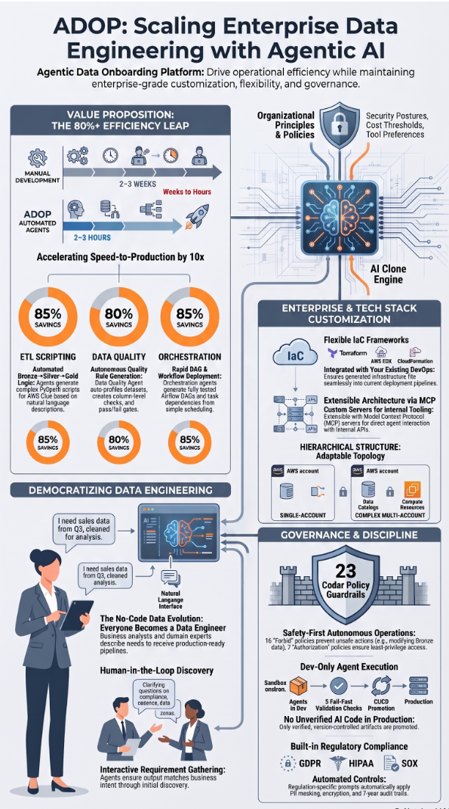
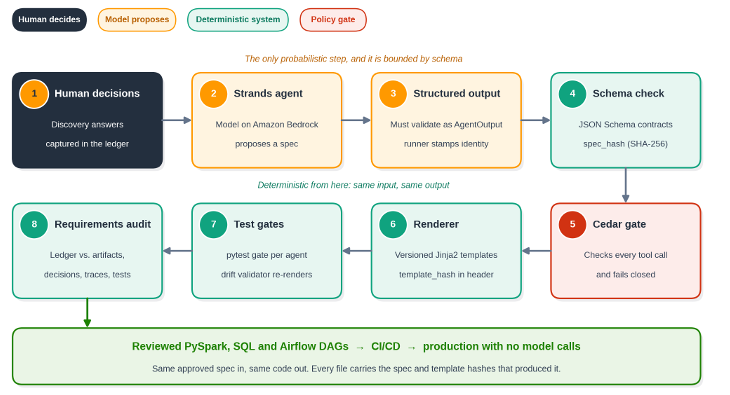
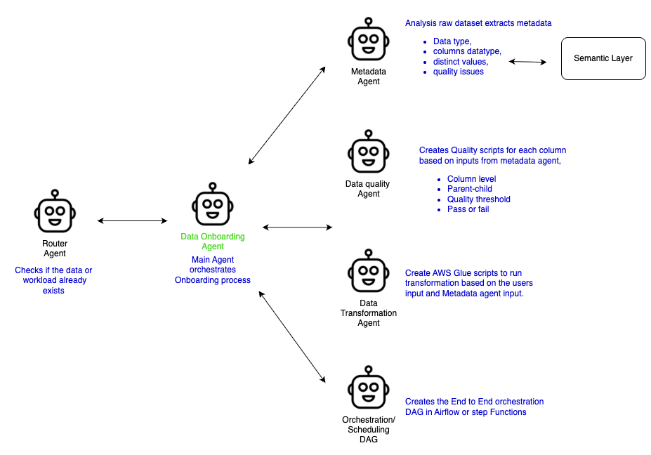
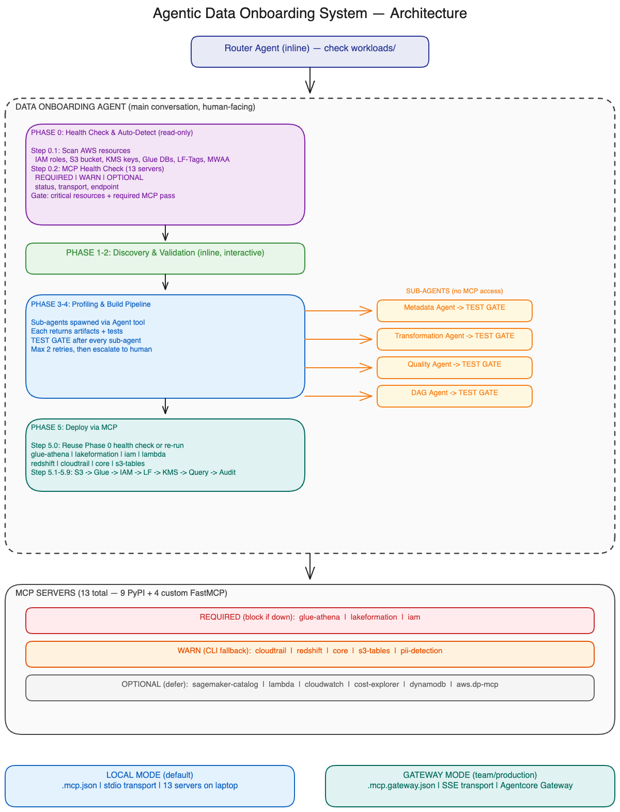

# ADOP — Agentic Data Operations Platform

ADOP turns a plain-language data request into a human-approved, tested, and
auditable Bronze → Silver → Gold data workload.

It coordinates discovery, profiling, quality, transformations, orchestration,
security, observability, deterministic code generation, and deployment
verification. The human owns business decisions; agents produce validated
artifacts and evidence.



## Demo

[](https://youtu.be/YiEm9c8kat0)

▶ Click the image to watch the ADOP demo on YouTube.

## One goal, four client paths plus optional Strands

Claude Code, Codex, Amazon Q Developer, and Kiro use different native
interfaces but follow the same contracts, phases, guardrails, tests, and audit
model.

| Platform | Start here | Dynamic workflow |
|---|---|---|
| Claude Code | `CLAUDE.md`, `.claude/` | `/onboard-workflow [REGULATION]` |
| Codex | `AGENTS.md`, `.codex/` | `$command-onboard-workflow [REGULATION]` |
| Amazon Q Developer | `AmazonQ.md`, `.amazonq/` | `q chat --agent adop-orchestrator` |
| Kiro | `.kiro/` | `python3 scripts/kiro_workflow.py init --workload <name>` |
| Headless AWS Strands | `scripts/run_strands.py` | `python3 scripts/run_strands.py run --args <args.json> --region <region> --model <model-id>` |

Shared behavior:

- mandatory human discovery before artifact generation;
- versioned source and zone contracts;
- requirements capture and requirements auditing;
- Cedar authorization and MCP guardrails;
- deterministic rendering, tests, traces, and deployment evidence.

Cost attribution is shared across Claude Code, Codex, and Kiro. Each workload
asks the user during Phase 1 to confirm its project, environment, cost center,
owner/team, and Bedrock Application Inference Profile (or approve provisioning
one). It then records usage by project, workload, run, phase, and agent; live
Bedrock execution is blocked when the approved attribution config is missing.
See [`docs/cost-attribution.md`](docs/cost-attribution.md).

Platform-specific behavior is kept in the native root folders and portable
snapshots under [`adapters/`](adapters/). The Claude Code plugin is separately
installable for use from another repository.

The platforms coexist in one checkout. Each has its own hook wiring
(`.claude/settings.json`, `.codex/hooks.json`, `.kiro/hooks/adop-gates.json`,
`.amazonq/cli-agents/`), and all of them call the same `shared/` renderer,
contracts, and auditor. When you change a root surface such as `.kiro/hooks/`,
copy the change to its `adapters/` snapshot. `sync_platforms.py check` verifies
that required files exist and that the security hooks (`cedar_gate.py`,
`deploy_gate.py`) are identical and registered on every platform; it does not
compare other file contents.

The deploy gate is opt-in and disabled by default. Set `ADOP_DEPLOY_GATE=1` to
activate hook-level blocking of deploy mutations after the requirements audit.

## Quick start

```bash
git clone https://github.com/aws-samples/sample-Agentic-Ai-Data-Operations.git
cd sample-Agentic-Ai-Data-Operations
```

## ADOP deployment modes

ADOP has a deliberate path from local experimentation to a shared AWS
environment:

```text
1. Local mode       → test the UI, CLI, policies, contracts, and workspaces
2. AWS Dev mode     → validate shared identity, persistence, connectors, and AWS integration
3. AWS staging/prod → promote the same application with environment-specific controls
```

Use **Local mode first** for testing and proof-of-concept work. Use **AWS Dev
mode** when you are ready to test real AWS persistence, SSO, Secrets Manager,
connector networking, and shared access. Do not point a local proof-of-concept
at production credentials or production configuration.

| Mode | Use it for | UI and API | Source of truth | Identity and isolation |
|---|---|---|---|---|
| **Local mode** | POCs, development, demos, offline CLI work | Local Python API and static UI on `localhost` | Local JSON control-plane store and repository configuration | Seeded test users with soft organization/domain/project isolation |
| **AWS Dev mode** | Shared development and integration testing | CloudFront/S3 UI, API Gateway, and Lambda | DynamoDB versions, approvals, current pointers, and audit records | Cognito or external OIDC such as Okta/Entra, with API authorization |
| **AWS staging/production** | Controlled shared or customer-facing operation | Same deployable AWS architecture with stricter environment controls | DynamoDB and Secrets Manager with backups, monitoring, and change controls | SSO, IAM, KMS, VPC/private connectivity, and environment boundaries |

### 1. Local mode: the recommended starting point

Start the local control plane:

```bash
python3 -m api.local_server
```

Open `http://127.0.0.1:4173`. For CLI testing, use the local identity and
workspace commands:

```bash
adop login --user hcherian@example.com
adop workspace list
adop workspace use project/orders
adop whoami
```

Local mode keeps the API, policy projection, connector metadata, and test
workspaces on the machine. It uses the same organization/domain/project
vocabulary, contract validation, approval intent, and UI/CLI authorization
rules as AWS mode, but it is only **soft isolation inside one checkout**. Use
disposable test credentials or environment-variable references; never use
production passwords, tokens, or private keys locally.

The local API binds to loopback and accepts identity headers only from its
local UI origin. This prevents an unrelated webpage from impersonating a test
user through the browser. For a shared or remote environment, use AWS mode;
local mode is not a tenant boundary.

### 2. AWS Dev mode: the first shared environment

After local UI and CLI tests pass, deploy the CloudFormation foundation to an
AWS development account. Use environment-specific values for the callback
URLs and hosted UI:

```bash
./infra/cloudformation/deploy.sh \
  --stack adop-console-dev \
  --region us-east-1 \
  --environment dev \
  --callback-url https://<dev-console-domain>/ \
  --logout-url https://<dev-console-domain>/ \
  --hosted-ui-prefix adop-console-dev-<unique-suffix> \
  --allowed-origin https://<dev-console-domain>
```

The AWS CLI and runtime use the same AWS control-plane store as the UI:

```bash
export ADOP_ENV=aws
export ADOP_CONTROL_PLANE_BACKEND=dynamodb
export ADOP_CONTROL_PLANE_TABLE=adop-control-plane-dev
export AWS_REGION=us-east-1

adop workspace list
adop whoami
```

AWS Dev is where to validate real SSO claims, DynamoDB persistence, approval
flows, connector health, Secrets Manager references, and shared workspace
visibility. The CLI must use an approved AWS identity; do not copy browser
tokens into the repository.

The AWS UI saves a connector before a health check is run. Draft health checks
are intentionally disabled in AWS mode so a user cannot make the Lambda probe
an arbitrary host and port. The saved connector resolves its destination from
the authorized environment-scoped secret.

For connector health checks, store development secrets under the environment
prefix `adop/dev/` (for example, `adop/dev/orders/snowflake`). The Lambda role
can read only `adop/dev/*` in this stack. Keep staging and production secrets
under their matching environment prefixes.

### 3. AWS staging and production

Staging and production use the same application and CloudFormation assets as
AWS Dev, but with separate stacks, accounts or environments, tables, secrets,
KMS keys, domains, and identity configuration. Promote only after the AWS Dev
tests pass. Add the environment's required backups, monitoring, WAF, audit
retention, least-privilege IAM, and private connector networking before calling
it production-ready.

The CloudFormation foundation is in
[`infra/cloudformation/template.yaml`](infra/cloudformation/template.yaml).
The complete deployment contract and environment checklist are in
[`docs/console-deployment-modes.md`](docs/console-deployment-modes.md).

### UI and API: Local mode versus AWS mode

| Capability | Local mode | AWS mode |
|---|---|---|
| Browser | `http://127.0.0.1:4173` | CloudFront/private S3-hosted console |
| API | Local Python process | API Gateway → Lambda |
| Login | Local test users | Cognito or Okta/Entra/OIDC-backed SSO |
| Contracts and policies | Local proposal/approval store and repository projection | Versioned DynamoDB proposals and snapshots; policy changes remain reviewable |
| Workspaces | Local registry with soft isolation | DynamoDB workspace registry plus IdP membership and API enforcement |
| Connectors | Disposable local/test references | Secrets Manager, KMS, VPC/Glue/private connector path |
| CLI | Reads the local control-plane store | Uses the same AWS-backed authorization and configuration model as the UI |
| Runtime snapshot | Local resolved configuration and hash | Approved DynamoDB snapshot and hash recorded for the run |

The UI is therefore not a separate configuration system. In Local mode it
reads and writes the local control-plane adapter. In AWS mode it reads and
writes the shared API, which persists approved configuration in DynamoDB and
keeps secret values in Secrets Manager. Both modes must pass the same
authorization and contract-validation tests, and a run must capture a resolved
configuration snapshot so a mid-run UI change cannot alter an in-flight run.

The control-plane UI/API and both persistence adapters are implemented and
tested. One integration boundary remains explicit: the ADOP run bootstrap must
select `FileConfigProvider` in Local mode or `DynamoConfigProvider` in AWS mode
before a deployment can claim end-to-end runtime promotion from an approved
UI change. Until that bootstrap wiring is enabled, AWS proposals and snapshot
records are safely persisted and auditable, but they do not silently override
repository-based workload configuration.

### SSO login and roles

ADOP does not store user roles. Every request derives the role from the
signed-in identity, so access is managed in your identity provider.

**Browser login (AWS mode).** The console uses the OIDC authorization-code
flow with PKCE against the stack's Cognito Hosted UI. To sign in with Okta,
Entra ID, or another OIDC provider, deploy with the `ExternalOidcProviderName`,
`ExternalOidcIssuer`, `ExternalOidcClientId`, and `ExternalOidcClientSecret`
parameters; Cognito then brokers that provider. The client secret is a
deployment parameter only and never reaches the browser. User creation is
admin-only (`AllowAdminCreateUserOnly: true`); there is no public self sign-up.

**Groups become roles.** Add users to these Cognito (or federated IdP) groups:

| Group | ADOP role | Typical access |
|---|---|---|
| `adop-org-admins` | Organization admin | Everything, including workspace creation and user directory |
| `adop-security-admins` | Security admin | Cedar policy proposals and policy approvals |
| `adop-connector-admins` | Connector admin | Connector creation and health checks |
| `adop-auditors` | Auditor | Read-only, including the audit log |
| `adop-domain-owners` + `adop-domain-<name>-owners` | Domain owner | The domain and its projects |
| `adop-project-users` + `adop-project-<name>-users` | Project user | Only that project |
| none | Viewer | Signed in, no workspace access |

Tenant groups (`adop-domain-sales-owners`, `adop-project-orders-users`) decide
*which* domains and projects a user can see; domain owners inherit their
domain's projects. Role changes take effect at the user's next login. The API
enforces every rule server-side: two-person approval (authors cannot approve
their own change), tighten-only contracts, and per-project isolation.

**Local mode** skips SSO. The login screen offers seeded test users such as
`hcherian@example.com` (organization admin) and `oliver.orders@example.com`
(orders project user), defined in `shared/control_plane/authorization.py`.
Test login is refused whenever `ADOP_ENV` is not `local`.

**CLI and agents.** `adop login` stores the identity and selected workspace in
`~/.adop/sessions/` (never tokens or secrets). Locally, use a seeded user; in
AWS mode, provide the SSO identity through `ADOP_IDENTITY_JSON` or
`ADOP_USER_EMAIL`. Claude Code, Codex, and Kiro inherit that session: the Cedar
gate only allows workload writes inside the selected workspace, so an agent
never has more access than the person who signed in. See
[`docs/cli-workspaces.md`](docs/cli-workspaces.md).

### Console UI

The same console runs in both modes: at `http://127.0.0.1:4173` locally, or
behind CloudFront in AWS. The sidebar groups pages by purpose:

| Section | Page | What it is for |
|---|---|---|
| Operate | **Home** | Four headline metrics, then tabs: **Overview** (active data product and its Bronze → Silver → Gold path), **Approvals** (changes waiting on you), **Health** (30-day quality, freshness, PII-tag, and schema KPIs) |
| | Workloads, Runs | Workload details and run history |
| Govern | Contracts | Organization, domain, and project zone contracts, with tighten-only proposals |
| | Connectors | JDBC, Snowflake, Teradata, and Databricks connectors; credentials are Secrets Manager references and are never shown back |
| | Policies | Cedar policies and proposals |
| | Approvals, Audit log | Two-person review queue and the full change history |
| Administer | Workspaces | Create domains and projects (organization admins) |
| | Access | Your role, workspace memberships, feature permissions, and directory users |

The workspace switcher at the top of the sidebar changes the selected
organization, domain, or project. Pages and API results are filtered to that
scope and to your memberships, so project users see only their own project.

### Fresh-clone validation

From a clean clone, install the Python runtime and run the local console:

```bash
python3 -m venv .venv
source .venv/bin/activate
python3 -m pip install -e .
python3 -m api.local_server
```

In another terminal, install the browser-test dependency and run the local
Chromium suite:

```bash
cd ui
npm install
npm run test:chromium:local
```

Playwright starts or reuses the local API at `127.0.0.1:4173`. Test reports,
traces, browser output, SAM build output, caches, and local control-plane data
are ignored by Git. The AWS suite is opt-in and requires
`ADOP_AWS_CONSOLE_URL`, `ADOP_AWS_TEST_USER`, and `ADOP_AWS_TEST_PASSWORD`.

The real AWS connector/RDS experiment is not part of the default stack. It is
an explicitly gated, temporary test environment described in
[`docs/control-plane-e2e-plan.md`](docs/control-plane-e2e-plan.md). This keeps
local startup free of billable resources and prevents an accidental RDS
creation during normal CloudFormation deployment.

Open the repository with one supported client:

- Claude Code: start at the repository root and run `/onboard-workflow`.
- Codex: run `python3 scripts/start_codex.py`, then use
  `$command-onboard-workflow`. For a clean customer project, install the
  named specialist contracts using
  [`docs/codex-specialist-setup.md`](docs/codex-specialist-setup.md).
- Amazon Q: start Q at the repository root and use
  `q chat --agent adop-orchestrator`.
- Kiro: initialize with
  `python3 scripts/kiro_workflow.py init --workload <name>`.
- Headless Strands: install the optional dependency with
  `pip install -e '.[strands]'`, then run
  `python3 scripts/run_strands.py status` followed by the `run` command above.
  See [Headless AWS Strands runtime](#headless-aws-strands-runtime).

### Claude Code plugin

Use the plugin when ADOP should operate in another repository. Install the
Claude plugin from the configured marketplace or local plugin path, run its
preflight, and invoke `/adop:onboard-workflow`.

Codex, Amazon Q, and Kiro use their native project surfaces; they do not
require the Claude plugin.

### Headless AWS Strands runtime

[`runtimes/strands/`](runtimes/strands/) runs Phase 3 profiling and the Phase 4 build
sub-agents in-process with the [AWS Strands Agents SDK](https://strandsagents.com) on
Amazon Bedrock. It plugs into the same `WorkflowDriver` as the Amazon Q path
(`shared/orchestration/workflow_driver.py`, `--runtime strands`), so the
build order, pytest test gates, retries, and traces are identical.

| Aspect | Behavior |
|---|---|
| Scope | Phase 3 `profile` (read-only) and Phase 4 `run`: metadata ‖ quality → transform → DAG → optional ontology → reviewer. Discovery questions (0–2) and deploy (5) stay in a human-facing client. |
| Phase 3 AWS access | Fixed read-only `aws_ro_*` tools only: Glue `get_*`, S3 list (≤100 keys) and sample (≤256 KiB), Athena single row-capped `SELECT`. Output is candidates in `run/source_profile.json` for the human to confirm. |
| Agent definitions | Loaded from `.amazonq/cli-agents/adop-*.json` (prompt, resources, `fs_write` allowlist) |
| Tools | `fs_read`, `fs_write`, `run_pytest_gate`, `render_artifact`. There is no shell tool and no MCP. |
| Write guards | No writes to `scripts/`, `dags/`, `sql/` (use `render_artifact`); no `.py` outside `workloads/*/tests/`; orchestrator-owned run state (`run/context.json`, `run/requirements.jsonl`, discovery markers) is read-only |
| Cedar policies | Every tool call passes a Strands `BeforeToolCallEvent` hook that applies the same `shared/policies/` as Claude Code, Codex and Kiro (`adop_strands/cedar_hook.py`) |
| Handoff | Strands structured output validated as `AgentOutput`. The runner stamps `agent_name`, `workload_name`, `run_id`, and timestamps itself rather than trusting the model. |
| Review gate | Blocks on `Severity: HIGH` in `reviews/security-findings.md`, ignoring markdown emphasis and case |
| Dependency | Optional extra `strands` (`strands-agents==1.62.0`); nothing else imports it |

```bash
pip install -e '.[strands]'
python3 scripts/run_strands.py status                       # list loadable agents
python3 scripts/run_strands.py run --args args.json --dry-run   # offline contract check
python3 scripts/run_strands.py profile --args args.json \
  --region us-east-1 --model <bedrock-model-id> --athena-output s3://<results>/  # Phase 3
python3 scripts/run_strands.py run --args args.json \
  --region us-east-1 --model <bedrock-model-id> --run-id <id>    # live Bedrock run
```

`args.json` is the onboarding args object produced after discovery (see
`.claude/commands/onboard-workflow.md`). A live run makes Bedrock calls and
writes workload artifacts, so run it on a workload whose files you can
review and revert. The ontology agent's Glue `get_table` tool is not yet
wired through Strands, and AgentCore Runtime deployment is not implemented.
The `strands-agentcore` extra is reserved for that.

### Deterministic by design, proven with AWS Strands

The headless AWS Strands runtime shows ADOP's determinism most clearly, because
no one is at the keyboard to catch a mistake. The model has one job: propose a
spec. Everything after that is deterministic.



*The model proposes; contracts, gates, and templates decide what gets built.*

See [`docs/determinism.md`](docs/determinism.md) for details.

## Prompt format

Give the agent the business outcome and confirmed constraints:

```text
Onboard <source> into <target zones>.
Source: <location, type, format, cadence>
Business outcome: <what Gold must answer>
Transformations: <confirmed cleaning and derived-column rules>
PII/compliance: <columns and framework, or none>
Quality: <thresholds and critical rules, or "use defaults">
Schedule: <cron and IANA timezone>
Ontology: <opt in/out and consumers>
```

The agent may profile schema, nulls, row counts, and formats, but it must ask
the human to confirm missing business decisions. It must not guess primary
keys, deduplication, null handling, PII, schedules, or transformations.

## Workflow phases

| Phase | Purpose | Gate |
|---|---|---|
| 0. Health and discovery | Check workloads, source metadata, credentials, and tools | Source and access confirmed |
| 1. Requirements | Capture source, zone, transformation, PII, quality, schedule, and ontology decisions | All mandatory answers provided |
| 2. Deduplication and context | Detect overlap and create the run context and requirements ledger | Conflicts resolved |
| 3. Profiling | Inspect representative data and present quality/PII observations | Human confirms handling |
| 4. Build and test | Validate specs, render artifacts, and run tests | Plan and tests approved |
| Audit | Compare Q&A with context, decisions, traces, tests, artifacts, and deployment evidence | Requirements audit passes |
| 5. Deploy and verify | Deploy through approved tools and run post-deployment checks | Human approval and verification |

After deployment, the workflow offers the optional E2E pipeline test and DevOps
production-readiness workflow.

## Provider-neutral extension model

The business contracts are independent of the execution backend. A future
adapter for `aws_glue`, `emr_spark`, `dbt_snowflake`, or `databricks` should
reuse the same source/zone contracts and add only:

- versioned execution-target and `runtime.yaml` settings;
- client-specific MCP registration without credentials in Git;
- provider-aware health checks and post-deployment verification;
- requirements-auditor evidence linking requirements to models, jobs, tables,
  tests, and deployment results.

## Agent Coordination Workflow



```text
User request
    ↓
Router → existing workload or new onboarding
    ↓
Human discovery + requirements ledger
    ↓
Metadata / Quality / Transformation / DAG / Ontology agents
    ↓
Renderer + tests + requirements auditor
    ↓
Human approval → deployment → verification
```

Specialist agents have narrow responsibilities and cannot bypass the human
gate. Sub-agents generate and test artifacts. They do not use AWS or MCP, with
one exception: the ontology agent has read-only Glue `get_table`.

## AI Clone Decision Engine

The AI Clone Decision Engine encodes the organization’s operating philosophy
into runtime routing and guardrails. It keeps agents on the approved path even
when the platform, MCP availability, or execution backend changes.

Decision flow:

```text
User intent
  → context gate
  → server health
  → intent/tool match
  → Cedar and MCP policy check
  → approved fallback or human escalation
  → decision, trace, and requirements evidence
```

Non-negotiable principles:

- human-approved requirements outrank agent assumptions;
- required-server failures block;
- optional-server fallbacks are explicit and audited;
- MCP is preferred when the approved server is healthy;
- Bronze is immutable and quality gates cannot be bypassed;
- credentials and infrastructure secrets never enter artifacts;
- deployment, repair, retry, and fallback decisions are traced.

Routing and policy sources:

| File | Purpose |
|---|---|
| [`TOOL_ROUTING.md`](TOOL_ROUTING.md) | Intent-to-tool mappings and disqualifiers |
| [`MCP_GUARDRAILS.md`](MCP_GUARDRAILS.md) | Phase-specific MCP permissions |
| [`tool-registry/servers.yaml`](tool-registry/servers.yaml) | Server capabilities and fallbacks |
| [`tool-registry/invariants.yaml`](tool-registry/invariants.yaml) | Organization-wide BLOCK/WARN rules |
| `shared/policies/` | Cedar agent authorization and safety policies |



## Contracts: the source of truth

Concept contracts define what must be true. JSON Schema contracts define how
those decisions are represented and validated in
[`contracts/`](contracts/README.md).

Authority order:

```text
Human Q&A → concept contract → versioned schema → Cedar/quality gates
          → deterministic renderer → artifacts and evidence
```

### Zone contracts

| Zone | Design principle | Required decisions |
|---|---|---|
| Bronze | Preserve raw source data; immutable after ingestion | Path, format, landing, catalog, retention, replay/idempotency |
| Silver | Validated, standardized Apache Iceberg data | PK, dedup, nulls, casts, PII masking, schema evolution, quality |
| Gold | Business-purpose serving data | Outcome, grain, KPIs, schema type, consumers, retention |

Default gates are Silver ≥ 0.80 and Gold ≥ 0.95. Critical failures block
promotion.

### Data KPI contracts (mandatory, planned)

Every workload will publish technical data KPIs. These are defined in the organization contract (`contracts/policies/organization/default.yaml`) and cover:
- quality score
- completeness, uniqueness and validity
- quarantine rate and row-count reconciliation
- volume anomaly
- run success and duration, plus mean time to recovery
- freshness lag and SLA attainment
- schema drift
- PII tag coverage
- cost per run

The organization contract also sets thresholds, cadence, storage and dashboard settings. Domains may add KPIs or tighten thresholds; projects and per-run overrides cannot change them. Once a KPI is set it can only be enhanced, never removed or loosened.

Results append to an Iceberg table with a JSON payload, so new KPIs need no schema change. From there they are published to CloudWatch with no SNS notifications, and they can be queried from QuickSight or Quick Suite.

### Source contracts

Supported source types are defined by
[`source_profile.schema.json`](contracts/v1/source_profile.schema.json).
Each workload records the source contract in
`workloads/{name}/config/source.yaml`.

| Source | Required decisions |
|---|---|
| CSV, Parquet, JSON, Avro | Location, format, partitioning, schema evolution, malformed-record, retention, replay |
| JDBC | Secret reference, table/query, PK, watermark, consistency, extraction window, failure handling |
| Kafka | Cluster/topic, event key, consumer group, offsets, schema, ordering, late events |
| Kinesis | Stream, partition key, checkpoint, retention, trigger, throughput, late events |

Contracts are created and confirmed before artifact generation. Generated
artifacts are evidence of the contract; they cannot override it.

Implementation status: the source contract accepts `jdbc`, `kafka`, and
`kinesis`, but the `bronze_ingestion` template reads only file sources
(`csv`, `parquet`, `json`, `avro`, `orc`) from S3. Those three types are
contract-level only until an ingestion template exists for them.

### How contracts are wired

One chain connects each contract to the code that enforces it. Extending a
contract means extending every link in it.

```text
contracts/vN/<type>.schema.json    shape of the spec (JSON Schema 2020-12)
  ↓ SPEC_TYPE_TO_SCHEMA            shared/codegen/spec_loader.py: spec type → schema file
  ↓ workloads/<wl>/config/*.yaml   spec instance; its "schema_version" picks vN
  ↓ shared/templates/<id>.j2       header declares template_id, version,
  ↓                                required_slots, schema_version
  ↓ renderer.render()              validates slots, refuses unsupported values,
  ↓                                writes artifact + 5-line provenance header
  ↓ drift_validator                template_id → spec type → spec file; re-renders
                                   and compares bytes
```

| Contract | Schema | Spec file | Template(s) | Produced by |
|---|---|---|---|---|
| Source | `source_profile` | `config/source.yaml` | none (input to Bronze) | metadata agent |
| Bronze zone | `bronze_spec` (v1, v2) | `config/bronze.yaml` | `bronze_ingestion` | transformation agent |
| Silver zone | `silver_spec` | `config/silver.yaml` | `silver_transform`, `iceberg_ddl` | transformation agent |
| Gold zone / target | `gold_spec` (v1, v2) | `config/gold.yaml` | `gold_aggregate`, `iceberg_ddl` | transformation agent |
| Quality | `quality_spec` | `config/quality_rules.yaml` | `quality_check` | quality agent |
| Orchestration | `dag_spec` (v1, v2) | `config/schedule.yaml` | `airflow_dag`, `glue_job_config` | DAG agent |
| Run state | `run_context` | `run/context.json` | none | orchestrator only |

### Extending contracts

Versioning rule (see [`contracts/README.md`](contracts/README.md)): a
published schema is immutable. Adding an optional field with a default is
allowed in place. Adding or removing a required field means a new version
directory (`v2` added required catalog and idempotency fields to
`bronze_spec`). Specs choose their version through `schema_version`.

**New data source** (for example, JDBC ingestion or a SaaS API):

1. Add the type to `source.type` (and `format` if needed) in
   `source_profile.schema.json`, plus any source-specific fields. Credentials
add    are always a reference (`credentials.type` + `connection_id`), never a value.
2. Add the source's discovery questions to
   `.claude/rules/00-zone-questions.md` and its copies in
   `.kiro/steering/` and `.amazonq/rules/`. Codex has no copy of this file;
   update `AGENTS.md` and `.codex/skills/command-onboard-workflow/`. List the
   source's required decisions in the source table above.
3. Add an ingestion branch to `bronze_ingestion.py.j2`, or a new template,
   behind a version bump. Use `unsupported()` for any value the branch can't
   implement. Keep the runtime input guard: the S3 check applies only to
   file sources.
4. If discovery needs a provider MCP server, add it to
   `tool-registry/servers.yaml` and a profile under `mcp-profiles/`
   (disabled by default) with a Phase 0 health check.
5. Add tests: schema accept/reject cases, a render test, and a refusal test
   for unsupported values.

**New zone or zone capability** (for example, a new Silver dedup mode or an
extra curated layer):

1. A new enum value or optional field goes into the zone's schema. For
   example, `silver_spec.dedup_strategy` is currently `keep_latest`,
   `keep_first`, `drop_exact_duplicates_only` or `none`. A new required field
   means a new version.
2. A new zone gets its own `<zone>_spec.schema.json`, an entry in
   `SPEC_TYPE_TO_SCHEMA`, a template with header metadata, and an entry in
   `drift_validator._template_id_to_spec_type` and `_find_spec_file`.
3. Define its quality gate (Silver ≥ 0.80 and Gold ≥ 0.95 today) in
   `quality_spec` and the Cedar policies under `shared/policies/`. Gates can't
   be bypassed.
4. Add the zone's questions to the discovery rules and its fields to
   `run_context.human_answers`. The human supplies them, and sub-agents only
   translate them.
5. Update the sub-agent that produces the spec. Its definition exists once per
   platform: `.claude/agents/`, `.codex/agents/`, `.amazonq/cli-agents/`, and
   `.kiro/agents/`.

**New data target** (for example, a new Gold serving shape or a non-Glue backend):

1. A new Gold serving shape is a new `gold_spec.schema_type` value (today
   `star_schema`, `flat_iceberg`, `iceberg_dynamodb`) plus a branch in
   `gold_aggregate.py.j2` and the DDL template.
2. A new execution backend (EMR Spark, dbt/Snowflake, Databricks) should keep
   the zone specs unchanged. Put backend settings in a separate,
   versioned execution-target contract and add backend-specific templates.
   Neither exists yet. See
   [Dynamic routing and BYO technology stack](#dynamic-routing-and-byo-technology-stack).
3. Extend post-deployment verification
   (`shared/utils/post_deployment_verifier.py`) and the requirements auditor
   so the target's tables, jobs and grants show up as evidence.

After any template change, re-render the affected artifacts, then run
`python3 -m shared.codegen.drift_validator workloads/<wl>` and the test suites.

### Generated-code guardrails

Everything under `workloads/*/scripts/`, `dags/`, and `sql/` is rendered by
`shared.codegen.renderer.render()` and checked by
`shared.codegen.drift_validator`. A template edit therefore requires
re-rendering the affected artifacts. The templates refuse unsafe spec values
at render time rather than emitting them:

- `quality_check`: a `custom_sql` predicate containing `;`, `--`, `/*`, or a
  DDL/DML/DCL keyword (DROP, CREATE, ALTER, TRUNCATE, INSERT, UPDATE, DELETE,
  MERGE, GRANT, REVOKE) is rejected; `F.expr()` takes one boolean expression.
- `bronze_ingestion`: after Glue job arguments are substituted, `source_path`
  and `landing_zone` must be well-formed S3 URIs. Control characters, other
  schemes, invalid bucket names, and `..` segments are rejected.

Tests: `shared/tests/unit/test_codegen_security_guards.py`.

## Security and policy enforcement

Claude Code, Codex, and Kiro enforce the same rules with the same code. Each
platform registers thin `PreToolUse` hooks; the hooks are byte-identical across
platforms and call one shared engine, so a policy change applies everywhere.
`scripts/sync_platforms.py check` fails if a hook copy drifts or a platform
stops registering it.

| Control | What it enforces | Claude Code | Codex | Kiro |
|---|---|---|---|---|
| Cedar authorization | Every tool call checked against `shared/policies/` | `cedar_gate.py` | `cedar_gate.py` | `cedar_gate.py`, plus one per agent |
| SEC-001 secrets | No hardcoded keys, private keys, or password literals in any write | Cedar | Cedar | Cedar + `block_credentials.py` |
| Discovery gate | No pipeline artifacts before the human answers Phase 1 | `check-discovery-gate.sh` | `discovery_gate.py` | `phase_gate.py` |
| Template codegen | `scripts/`, `dags/`, `sql/` written only by the renderer | `enforce_template_codegen.py` | `enforce_template_codegen.py` | `enforce_template_codegen.py` |
| Audit before deploy | When enabled, no Glue/IAM/Lake Formation/DAG mutation until the requirements audit passes | `deploy_gate.py` | `deploy_gate.py` | `deploy_gate.py` + `kiro_workflow.py deploy-check` |

The optional headless Strands runtime (Phase 4, started from any of the three
clients) applies the same Cedar policies through a Strands `BeforeToolCallEvent`
hook, so a tool call gets the same verdict on all four runtimes.

### Security features by layer

| Layer | Security features |
|---|---|
| Agent and tool access | Cedar authorization for every tool call; agent-specific write permissions; unknown and general helper agents cannot invoke AWS/MCP tools; hardcoded secrets are blocked; agents cannot edit policies or deployment gate records. |
| Human approval and workflow | Discovery gates require explicit human answers before pipeline generation; compliance, PII, quality, transformation, schedule, and ontology decisions are recorded as requirements and decisions. |
| Code and artifact generation | Deterministic renderer-only generation for pipeline scripts, DAGs, and SQL; schema validation, drift detection, and template/codegen hooks prevent unauthorized generated-artifact changes. |
| Data and pipeline | PII detection and tagging; Lake Formation LF-Tags and TBAC; Bronze immutability; quality gates block Silver/Gold promotion; no credentials or infrastructure identifiers in workload code. |
| Deployment and infrastructure | Requirements audit and preflight checks; optional deploy hook (`ADOP_DEPLOY_GATE=1`); workload-scoped least-privilege IAM; read-only IAM simulation; active-run protection; no hand-written deployment gate records. |
| Runtime and operations | KMS encryption, TLS in transit, structured logs, agent traces, CloudTrail audit events, deployment verification, and post-deployment checks for Glue, Athena, MWAA, IAM, KMS, Lake Formation, and TBAC. |

The deploy hook is disabled by default and becomes active when
`ADOP_DEPLOY_GATE=1` is set. Cedar decisions are logged to
`logs/cedar_decisions.jsonl`; the repository currently has Cedar in `audit` mode,
so a human must change the protected enforcement configuration to `enforce` before
policy denials block tool calls globally.

### Cedar policies

The engine is `shared/utils/cedar_gate.py`. It uses the real Cedar evaluator
(`cedarpy`, a required dependency) and loads every policy under
`shared/policies/` except templates.

- **Who is calling.** Claude Code and Codex send the subagent's `agent_type` in
  the hook input. Kiro does not, so each Kiro agent declares its own hook with
  `--principal <id>`. The main conversation is `onboarding`; recognized helper
  agents (Explore, general-purpose, plugin helpers) are `general`; unknown
  identities resolve to `unknown` and fail closed.
- **Agents write only their documented outputs.** For example, the metadata
  agent writes `config/` and its tests; the DAG agent writes `dags/`, its spec,
  and its tests. See `shared/policies/agent_authorization/`.
- **Sub-agents have no AWS access.** MCP tools, Kiro `use_aws`, and the `aws`
  CLI in a shell are denied for ADOP sub-agents and general/unknown helpers. The
  one exception is the ontology agent, which may call `get_table`.
- **No agent can edit the rules.** `shared/policies/**` and
  `run/deploy_gate.json` are write-protected for every agent, including the
  main conversation, whether the edit is a file write, `sed -i`, `rm`, a
  redirect, or `git checkout`. Policy changes are made by a human. The IaC
  agent stages Cedar drafts at `workloads/<name>/iac/policies/` for a human to
  promote.
- **General agents** may write under `workloads/`, but may not write run state
  or audit records, because that would forge a human gate.
- **Fails closed.** A missing `cedarpy`, an unreadable mode file, or an
  evaluation error denies the call.

**Mode.** `shared/policies/enforcement.json` sets `audit` or `enforce`. In
`audit`, every decision is logged to `logs/cedar_decisions.jsonl` and nothing is
blocked; in `enforce`, denies are blocked. Only a human changes the mode.
Restart the client after changing hooks or the mode.

### Deployment safety

Phase 5 deploys only through the shared gates in
`shared/utils/deployment_checks.py`, the same on all three platforms:

1. `preflight` refuses to run unless `run/requirements_audit.json` passes, matches
   the current run, and is newer than every config and generated artifact.
2. `simulate` runs read-only IAM simulation for the MWAA role (`glue:GetJob`,
   `glue:StartJobRun`, `iam:PassRole`) and the Glue role (catalog and KMS).
3. `active-runs` blocks a manual job start while another run is in flight.
4. `post_deployment_verifier.py` (Step 5.9) checks tables, Athena, LF-Tags,
   TBAC, KMS, the MWAA DAG (including import errors), both roles, and CloudTrail.

### Limits

- Files a sub-agent writes through a shell, such as the renderer's output, are
  not checked as file writes. Shell commands are checked for `aws` CLI use and
  for writes to policies or the deploy gate.
- Pipeline guardrails (DQ, INT, OPS, SEC-002 to SEC-004) depend on run-time
  data and are evaluated by the pipeline, not at tool-call time.
- The installable Claude Code plugin does not ship `shared/policies/` or the
  Cedar engine. Amazon Q Developer is not covered by these hooks.

Tests: `core/tests/test_cedar_enforcement.py`, `core/tests/test_audit_deploy_gate.py`,
`core/tests/test_deployment_checks.py`. Details: [docs/security.md](docs/security.md).

## Dynamic workflows

| Platform | Onboarding | Production readiness |
|---|---|---|
| Claude Code | `/onboard-workflow [REGULATION]` | `/devops-workflow [WORKLOAD] [FRAMEWORK]` |
| Codex | `$command-onboard-workflow [REGULATION]` | `$command-devops-workflow [WORKLOAD] [FRAMEWORK]` |
| Amazon Q | `q chat --agent adop-orchestrator` | `q chat --agent adop-devops` |
| Kiro | `kiro_workflow.py init`, `gate`, `audit` | Kiro DevOps agent after workload gates |
| Headless Strands | `run_strands.py run` (Phase 4 build after discovery) | Not covered |

The native definitions are under `.claude/commands/`,
`.codex/skills/`, `.amazonq/cli-agents/`, and `.kiro/`.

## Dynamic routing and BYO technology stack

Business intent is separated from execution technology. The same contracts can
target AWS Glue/Iceberg today and future EMR Spark, dbt/Snowflake, or
Databricks adapters.

Keep business rules in zone specifications. Keep backend settings—workers,
Spark memory, warehouses, clusters, region, retries, and tool allowlists—in
execution-target configuration.

A new backend must preserve discovery, contracts, deterministic rendering,
tests, read-only versus mutation tool separation, traces, audit evidence, and
post-deployment verification.

## Third-party MCP integrations

Snowflake, Databricks, and Teradata profiles exist but are disabled by default.
Enable them only after provider authentication, least-privilege permissions,
tool allowlists, and Phase 0 health checks are configured.

Provider-native MCP connections are for governed discovery, profiling, query
validation, or provider-specific operations. Credentials and private endpoints
must remain in the client secret store or environment—not in Git or workload
artifacts.

See [`mcp-profiles/third-party/README.md`](mcp-profiles/third-party/README.md)
for the disabled profiles and provider-specific setup references.

### A2A with Snowflake Cortex and Databricks Genie (optional, planned)

ADOP can act as an A2A orchestrator and validator, with Cortex and Genie as remote agents reached through ADOP-side adapters. It uses them for three things:
- checking after deployment that Gold tables are visible to them
- reconciling KPI answers against Athena ground truth
- dry-run-then-approve semantic-layer handoff

This is **optional and off by default**. Without opt-in, no A2A questions are asked, nothing connects to Cortex or Genie, and the standard Phase 0–5 flow and Step 5.9 checks are unchanged.

### Common lineage across AWS, Snowflake and Databricks (possible, planned)

ADOP can keep one shared lineage record across AWS, Snowflake and Databricks using [OpenLineage](https://openlineage.io/). OpenLineage defines the event format but does not store anything, so the shared store would be an append-only Iceberg table on S3, `adop_ops.lineage_events` (fixed columns plus the raw OpenLineage JSON):
- AWS Glue and MWAA send events through the Airflow OpenLineage provider and `openlineage-spark`.
- Databricks Spark clusters send events through `openlineage-spark`.
- Snowflake lineage is read from `ACCESS_HISTORY` and converted to OpenLineage events.

ADOP adds its quality scores, PII tags and contract hash to each event. All three platforms can query the table directly: Athena and QuickSight, Snowflake through its Iceberg catalog integration, and Databricks through Unity Catalog federation. Amazon DataZone or Marquez can optionally read the same events to draw lineage graphs. Today ADOP relies on native Glue Data Lineage (`--enable-data-lineage`), so this is an additive, optional step.

## Repository structure

```text
.claude/ .codex/ .amazonq/ .kiro/   Native client surfaces
adapters/                           Portable platform snapshots
contracts/                          Versioned workload schemas
shared/                             Renderer, audit, logging, policies, utilities
runtimes/strands/                   Optional headless AWS Strands build runtime
mcp-profiles/                       Default, demo, and disabled provider profiles
mcp-servers/                        Repository-owned FastMCP servers
tool-registry/                      MCP capabilities and invariants
workloads/                          Dataset-specific configs and artifacts
scripts/                            Validation, demo, workflow, and startup tools
plugins/claude-code/                Installable Claude Code plugin
docs/                               Detailed guides and diagrams
```

## Tests and readiness

```bash
python3 scripts/run_tests.py
python3 scripts/validate_integrations.py
python3 scripts/sync_platforms.py check
python3 scripts/mcp_demo.py check --profile demo

# optional Strands runtime (needs the strands extra)
python3 -m pytest runtimes/strands/tests -q
```

The demo check is read-only. AWS deployment requires the discovery gate,
human approval, Cedar authorization, requirements audit, and mandatory
post-deployment verification.

## Further documentation

- [Getting started](docs/getting-started.md)
- [Platform integration](docs/platform-integration.md)
- [MCP setup](docs/mcp-setup.md)
- [Contracts](contracts/README.md)
- [Tool routing](TOOL_ROUTING.md)
- [MCP guardrails](MCP_GUARDRAILS.md)
- [Running tests](docs/running-tests.md)
- [Security](docs/security.md)
- [Workflow diagrams](docs/workflow-diagrams.md)
- [AWS setup](docs/aws-account-setup.md)

## Status

The current implementation is optimized for AWS Glue PySpark, Apache Iceberg,
Athena, and Airflow/MWAA. Snowflake, Databricks, Teradata, EMR, and dbt are
integration extension points with disabled provider profiles unless explicitly
enabled.

## License

See the source repository for the applicable license terms.

